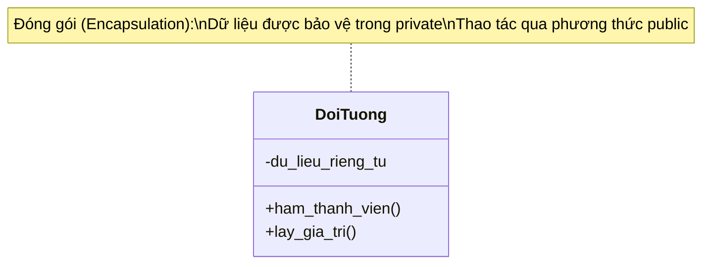

# 22.3 — Move constructors and move assignment

---

## 🎯 Mục Tiêu Bài Học
- Nắm vững bản chất lý thuyết và cơ chế hoạt động của **Move constructors and move assignment** trong tiêu chuẩn ISO C++.
- Hiểu rõ cách máy tính tổ chức bộ nhớ (RAM, CPU registers) khi thực thi mã nguồn liên quan.
- Nhận biết các cạm bẫy lỗi kinh điển (**Undefined Behavior**, Memory Leak, Bug logic) và cách phòng tránh.
- Áp dụng các quy tắc thực hành tốt nhất (**Best Practices**) chuẩn công nghiệp và cập nhật C++20/C++23 hiện đại.

---

# 22.3 &#8212; Move các hàm tạo (constructors) and move phép gán

Trong bài học [22.1 -- Introduction to smart các con trỏ and move semantics](https://www.learncpp.com/cpp-tutorial/introduction-to-smart-các con trỏ-move-semantics/), we took a look at std::auto_ptr, discussed the desire for move semantics, and took a look at some of the downsides that occur when các hàm designed for copy semantics (copy các hàm tạo (constructors) and copy phép gán các toán tử) are redefined to implement move semantics.

In this lesson, we’ll take a deeper look at how C++11 resolves these problems via move các hàm tạo (constructors) and move phép gán.

Recapping copy các hàm tạo (constructors) and copy phép gán

First, let’s take a moment to recap copy semantics.

Copy các hàm tạo (constructors) are used to khởi tạo a class by making a copy of an object of the same class.  Copy phép gán is used to copy one class object to another existing class object.  By default, C++ will provide a copy hàm tạo (constructor) and copy phép gán toán tử if one is not explicitly provided.  These trình biên dịch-provided các hàm do shallow copies, which may cause problems for classes that allocate dynamic memory.  So classes that deal with dynamic memory should override these các hàm to do deep copies.

Returning back to our Auto_ptr smart con trỏ class example from the first lesson in this chapter, let’s look at a version that implements a copy hàm tạo (constructor) and copy phép gán toán tử that do deep copies, and a sample program that exercises them:

```cpp
#include <iostream>

template<typename T>
class Auto_ptr3
{
	T* m_ptr {};
public:
	Auto_ptr3(T* ptr = nullptr)
		: m_ptr { ptr }
	{
	}

	~Auto_ptr3()
	{
		delete m_ptr;
	}

	// Copy constructor
	// Do deep copy of a.m_ptr to m_ptr
	Auto_ptr3(const Auto_ptr3& a)
	{
		m_ptr = new T;
		*m_ptr = *a.m_ptr;
	}

	// Copy assignment
	// Do deep copy of a.m_ptr to m_ptr
	Auto_ptr3& operator=(const Auto_ptr3& a)
	{
		// Self-assignment detection
		if (&a == this)
			return *this;

		// Release any resource we're holding
		delete m_ptr;

		// Copy the resource
		m_ptr = new T;
		*m_ptr = *a.m_ptr;

		return *this;
	}

	T& operator*() const { return *m_ptr; }
	T* operator->() const { return m_ptr; }
	bool isNull() const { return m_ptr == nullptr; }
};

class Resource
{
public:
	Resource() { std::cout << "Resource acquired\n"; }
	~Resource() { std::cout << "Resource destroyed\n"; }
};

Auto_ptr3<Resource> generateResource()
{
	Auto_ptr3<Resource> res{new Resource};
	return res; // this return value will invoke the copy constructor
}

int main()
{
	Auto_ptr3<Resource> mainres;
	mainres = generateResource(); // this assignment will invoke the copy assignment

	return 0;
}
```

In this program, we’re using a hàm named generateResource() to create a smart con trỏ encapsulated resource, which is then passed back to hàm main().  Function main() then assigns that to an existing Auto_ptr3 object.

When this program is run, it prints:

```cpp
Resource acquired
Resource acquired
Resource destroyed
Resource acquired
Resource destroyed
Resource destroyed
```

(Note: You may only get 4 outputs if your trình biên dịch elides the giá trị trả về from hàm generateResource())

That’s a lot of resource creation and destruction going on for such a simple program!  What’s going on here?

Let’s take a closer look.  There are 6 key steps that happen in this program (one for each printed message):

<ol start="1">
- Inside generateResource(), local biến res is created and được khởi tạo with a dynamically allocated Resource, which causes the first “Resource acquired”.

- Res is returned back to main() by value.  We return by value here because res is a local biến -- it can’t be returned by address or tham chiếu because res will be destroyed when generateResource() ends.  So res is copy constructed into a temporary object.  Since our copy hàm tạo (constructor) does a deep copy, a new Resource is allocated here, which causes the second “Resource acquired”.

- Res goes out of phạm vi truy cập (scope), destroying the originally created Resource, which causes the first “Resource destroyed”.

- The temporary object is assigned to mainres by copy phép gán.  Since our copy phép gán also does a deep copy, a new Resource is allocated, causing yet another “Resource acquired”.

- The phép gán biểu thức ends, and the temporary object goes out of biểu thức phạm vi truy cập (scope) and is destroyed, causing a “Resource destroyed”.

- At the end of main(), mainres goes out of phạm vi truy cập (scope), and our final “Resource destroyed” is displayed.

So, in short, because we call the copy hàm tạo (constructor) once to copy construct res to a temporary, and copy phép gán once to copy the temporary into mainres, we end up allocating and destroying 3 separate đối tượng in total.

Inefficient, but at least it doesn’t crash!

However, with move semantics, we can do better.

Move các hàm tạo (constructors) and move phép gán

C++11 defines two new các hàm in service of move semantics: a move hàm tạo (constructor), and a move phép gán toán tử.  Whereas the goal of the copy hàm tạo (constructor) and copy phép gán is to make a copy of one object to another, the goal of the move hàm tạo (constructor) and move phép gán is to move ownership of the resources from one object to another (which is typically much less expensive than making a copy).

Defining a move hàm tạo (constructor) and move phép gán work analogously to their copy counterparts.  However, whereas the copy flavors of these các hàm take a const l-value tham chiếu tham số (which will bind to just about anything), the move flavors of these các hàm use non-const rvalue tham chiếu tham số (which only bind to rvalues).

Here’s the same Auto_ptr3 class as above, with a move hàm tạo (constructor) and move phép gán toán tử added.  We’ve left in the deep-copying copy hàm tạo (constructor) and copy phép gán toán tử for comparison purposes.

```cpp
#include <iostream>

template<typename T>
class Auto_ptr4
{
	T* m_ptr {};
public:
	Auto_ptr4(T* ptr = nullptr)
		: m_ptr { ptr }
	{
	}

	~Auto_ptr4()
	{
		delete m_ptr;
	}

	// Copy constructor
	// Do deep copy of a.m_ptr to m_ptr
	Auto_ptr4(const Auto_ptr4& a)
	{
		m_ptr = new T;
		*m_ptr = *a.m_ptr;
	}

	// Move constructor
	// Transfer ownership of a.m_ptr to m_ptr
	Auto_ptr4(Auto_ptr4&& a) noexcept
		: m_ptr { a.m_ptr }
	{
		a.m_ptr = nullptr; // we'll talk more about this line below
	}

	// Copy assignment
	// Do deep copy of a.m_ptr to m_ptr
	Auto_ptr4& operator=(const Auto_ptr4& a)
	{
		// Self-assignment detection
		if (&a == this)
			return *this;

		// Release any resource we're holding
		delete m_ptr;

		// Copy the resource
		m_ptr = new T;
		*m_ptr = *a.m_ptr;

		return *this;
	}

	// Move assignment
	// Transfer ownership of a.m_ptr to m_ptr
	Auto_ptr4& operator=(Auto_ptr4&& a) noexcept
	{
		// Self-assignment detection
		if (&a == this)
			return *this;

		// Release any resource we're holding
		delete m_ptr;

		// Transfer ownership of a.m_ptr to m_ptr
		m_ptr = a.m_ptr;
		a.m_ptr = nullptr; // we'll talk more about this line below

		return *this;
	}

	T& operator*() const { return *m_ptr; }
	T* operator->() const { return m_ptr; }
	bool isNull() const { return m_ptr == nullptr; }
};

class Resource
{
public:
	Resource() { std::cout << "Resource acquired\n"; }
	~Resource() { std::cout << "Resource destroyed\n"; }
};

Auto_ptr4<Resource> generateResource()
{
	Auto_ptr4<Resource> res{new Resource};
	return res; // this return value will invoke the move constructor
}

int main()
{
	Auto_ptr4<Resource> mainres;
	mainres = generateResource(); // this assignment will invoke the move assignment

	return 0;
}
```

The move hàm tạo (constructor) and move phép gán toán tử are simple.  Instead of deep copying the source object (`a`) into the destination object (the implicit object), we simply move (steal) the source object’s resources.  This involves shallow copying the source con trỏ into the implicit object, then setting the source con trỏ to null.

When run, this program prints:

```cpp
Resource acquired
Resource destroyed
```

That’s much better!

The flow of the program is exactly the same as before.  However, instead of calling the copy hàm tạo (constructor) and copy phép gán các toán tử, this program calls the move hàm tạo (constructor) and move phép gán các toán tử.  Looking a little more deeply:

<ol start="1">
- Inside generateResource(), local biến res is created and được khởi tạo with a dynamically allocated Resource, which causes the first “Resource acquired”.

- Res is returned back to main() by value.  Res is move constructed into a temporary object, transferring the dynamically created object stored in res to the temporary object.  We’ll talk about why this happens below.

- Res goes out of phạm vi truy cập (scope).  Because res no longer manages a con trỏ (it was moved to the temporary), nothing interesting happens here.

- The temporary object is move assigned to mainres.  This transfers the dynamically created object stored in the temporary to mainres.

- The phép gán biểu thức ends, and the temporary object goes out of biểu thức phạm vi truy cập (scope) and is destroyed.  However, because the temporary no longer manages a con trỏ (it was moved to mainres), nothing interesting happens here either.

- At the end of main(), mainres goes out of phạm vi truy cập (scope), and our final “Resource destroyed” is displayed.

So instead of copying our Resource twice (once for the copy hàm tạo (constructor) and once for the copy phép gán), we transfer it twice.  This is more efficient, as Resource is only constructed and destroyed once instead of three times.

::: info Related content

Move các hàm tạo (constructors) and move phép gán should be marked as `noexcept`.  This tells the trình biên dịch that these các hàm will not throw exceptions.

We introduce `noexcept` in lesson [27.9 -- Exception specifications and noexcept](https://www.learncpp.com/cpp-tutorial/exception-specifications-and-noexcept/) and discuss why move các hàm tạo (constructors) and move phép gán are marked as `noexcept` in lesson [27.10 -- std::move_if_noexcept](https://www.learncpp.com/cpp-tutorial/stdmove_if_noexcept/).
:::

When are the move hàm tạo (constructor) and move phép gán called?

The move hàm tạo (constructor) and move phép gán are called when those các hàm have been defined, and the đối số for construction or phép gán is an rvalue.  Most typically, this rvalue will be a hằng giá trị (literal) or temporary value.

The copy hàm tạo (constructor) and copy phép gán are used otherwise (when the đối số is an lvalue, or when the đối số is an rvalue and the move hàm tạo (constructor) or move phép gán các hàm aren’t defined).

Implicit move hàm tạo (constructor) and move phép gán toán tử

The trình biên dịch will create an implicit move hàm tạo (constructor) and move phép gán toán tử if all of the following are true:

- There are no user-declared copy các hàm tạo (constructors) or copy phép gán các toán tử.

- There are no user-declared move các hàm tạo (constructors) or move phép gán các toán tử.

- There is no user-declared hàm hủy (destructor).

These các hàm do a memberwise move, which behaves as follows:

- If member has a move hàm tạo (constructor) or move phép gán (as appropriate), it will be invoked.

- Otherwise, the member will be copied.

Notably, this means that các con trỏ will be copied, not moved!

::: danger Cảnh báo nguy hiểm

The implicit move hàm tạo (constructor) and move phép gán will copy các con trỏ, not move them.  If you want to move a con trỏ member, you will need to define the move hàm tạo (constructor) and move phép gán yourself.

:::

The key insight behind move semantics

You now have enough context to understand the key insight behind move semantics.

If we construct an object or do an phép gán where the đối số is an l-value, the only thing we can reasonably do is copy the l-value.  We can’t assume it’s safe to alter the l-value, because it may be used again later in the program.  If we have an biểu thức “a = b” (where b is an lvalue), we wouldn’t reasonably expect b to be changed in any way.

However, if we construct an object or do an phép gán where the đối số is an r-value, then we know that r-value is just a temporary object of some kind.  Instead of copying it (which can be expensive), we can simply transfer its resources (which is cheap) to the object we’re constructing or assigning.  This is safe to do because the temporary will be destroyed at the end of the biểu thức anyway, so we know it will never be used again!

C++11, through r-value các tham chiếu, gives us the ability to provide different behaviors when the đối số is an r-value vs an l-value, enabling us to make smarter and more efficient decisions about how our đối tượng should behave.

::: info Hiểu biết cốt lõi

Move semantics is an optimization opportunity.

:::

Move các hàm should always leave both đối tượng in a valid state

In the above examples, both the move hàm tạo (constructor) and move phép gán các hàm set a.m_ptr to nullptr.  This may seem extraneous -- after all, if `a` is a temporary r-value, why bother doing “cleanup” if tham số `a` is going to be destroyed anyway?

The answer is simple: When `a` goes out of phạm vi truy cập (scope), the hàm hủy (destructor) for `a` will be called, and `a.m_ptr` will be deleted.  If at that point, `a.m_ptr` is still pointing to the same object as `m_ptr`, then `m_ptr` will be left as a dangling con trỏ.  When the object containing `m_ptr` eventually gets used (or destroyed), we’ll get hành vi không xác định (Hành vi không xác định (Undefined Behavior - UB) - UB).

When implementing move semantics, it is important to ensure the moved-from object is left in a valid state, so that it will destruct properly (without creating hành vi không xác định (Hành vi không xác định (Undefined Behavior - UB) - UB)).

Automatic l-values returned by value may be moved instead of copied

In the generateResource() hàm of the Auto_ptr4 example above, when biến res is returned by value, it is moved instead of copied, even though res is an l-value.  The C++ specification has a special rule that says automatic đối tượng returned from a hàm by value can be moved even if they are l-values.  This makes sense, since res was going to be destroyed at the end of the hàm anyway!  We might as well steal its resources instead of making an expensive and unnecessary copy.

Although the trình biên dịch can move l-value các giá trị trả về, in some cases it may be able to do even better by simply eliding the copy altogether (which avoids the need to make a copy or do a move at all).  In such a case, neither the copy hàm tạo (constructor) nor move hàm tạo (constructor) would be called.

Disabling copying

In the Auto_ptr4 class above, we left in the copy hàm tạo (constructor) and phép gán toán tử for comparison purposes.  But in move-enabled classes, it is sometimes desirable to delete the copy hàm tạo (constructor) and copy phép gán các hàm to ensure copies aren’t made.  In the case of our Auto_ptr class, we don’t want to copy our templated object T -- both because it’s expensive, and whatever class T is may not even support copying!

Here’s a version of Auto_ptr that supports move semantics but not copy semantics:

```cpp
#include <iostream>

template<typename T>
class Auto_ptr5
{
	T* m_ptr {};
public:
	Auto_ptr5(T* ptr = nullptr)
		: m_ptr { ptr }
	{
	}

	~Auto_ptr5()
	{
		delete m_ptr;
	}

	// Copy constructor -- no copying allowed!
	Auto_ptr5(const Auto_ptr5& a) = delete;

	// Move constructor
	// Transfer ownership of a.m_ptr to m_ptr
	Auto_ptr5(Auto_ptr5&& a) noexcept
		: m_ptr { a.m_ptr }
	{
		a.m_ptr = nullptr;
	}

	// Copy assignment -- no copying allowed!
	Auto_ptr5& operator=(const Auto_ptr5& a) = delete;

	// Move assignment
	// Transfer ownership of a.m_ptr to m_ptr
	Auto_ptr5& operator=(Auto_ptr5&& a) noexcept
	{
		// Self-assignment detection
		if (&a == this)
			return *this;

		// Release any resource we're holding
		delete m_ptr;

		// Transfer ownership of a.m_ptr to m_ptr
		m_ptr = a.m_ptr;
		a.m_ptr = nullptr;

		return *this;
	}

	T& operator*() const { return *m_ptr; }
	T* operator->() const { return m_ptr; }
	bool isNull() const { return m_ptr == nullptr; }
};
```

If you were to try to pass an Auto_ptr5 l-value to a hàm by value, the trình biên dịch would complain that the copy hàm tạo (constructor) required to khởi tạo the hàm tham số has been deleted.  This is good, because we should probably be passing Auto_ptr5 by const l-value tham chiếu anyway!

Auto_ptr5 is (finally) a good smart con trỏ class.  And, in fact the standard library contains a class very much like this one (that you should use instead), named std::unique_ptr.  We’ll talk more about std::unique_ptr later in this chapter.

Another example

Let’s take a look at another class that uses dynamic memory: a simple dynamic templated array.  This class contains a deep-copying copy hàm tạo (constructor) and copy phép gán toán tử.

```cpp
#include <cstddef> // for std::size_t

template <typename T>
class DynamicArray
{
private:
	T* m_array {};
	int m_length {};

	void alloc(int length)
	{
		m_array = new T[static_cast<std::size_t>(length)];
        	m_length = length;
	}
public:
	DynamicArray(int length)
	{
		alloc(length);
	}

	~DynamicArray()
	{
		delete[] m_array;
	}

	// Copy constructor
	DynamicArray(const DynamicArray &arr)
	{
		alloc(arr.m_length);
		std::copy_n(arr.m_array, m_length, m_array); // copy m_length elements from arr to m_array
	}

	// Copy assignment
	DynamicArray& operator=(const DynamicArray &arr)
	{
		if (&arr == this)
			return *this;

		delete[] m_array;

		alloc(arr.m_length);

		std::copy_n(arr.m_array, m_length, m_array); // copy m_length elements from arr to m_array

		return *this;
	}

	int getLength() const { return m_length; }
	T& operator[](int index) { return m_array[index]; }
	const T& operator[](int index) const { return m_array[index]; }
};
```

Now let’s use this class in a program.  To show you how this class performs when we allocate a million integers on the vùng nhớ Heap (Free Store), we’re going to leverage the Timer class we developed in lesson [18.4 -- Timing your code](https://www.learncpp.com/cpp-tutorial/timing-your-code/).  We’ll use the Timer class to time how fast our code runs, and show you the performance difference between copying and moving.

```cpp
#include <algorithm> // for std::copy_n
#include <chrono> // for std::chrono functions
#include <iostream>

// Uses the above DynamicArray class

class Timer
{
private:
	// Type aliases to make accessing nested type easier
	using Clock = std::chrono::high_resolution_clock;
	using Second = std::chrono::duration<double, std::ratio<1> >;
	
	std::chrono::time_point<Clock> m_beg { Clock::now() };

public:
	void reset()
	{
		m_beg = Clock::now();
	}
	
	double elapsed() const
	{
		return std::chrono::duration_cast<Second>(Clock::now() - m_beg).count();
	}
};

// Return a copy of arr with all of the values doubled
DynamicArray<int> cloneArrayAndDouble(const DynamicArray<int> &arr)
{
	DynamicArray<int> dbl(arr.getLength());
	for (int i = 0; i < arr.getLength(); ++i)
		dbl[i] = arr[i] * 2;

	return dbl;
}

int main()
{
	Timer t;

	DynamicArray<int> arr(1000000);

	for (int i = 0; i < arr.getLength(); i++)
		arr[i] = i;

	arr = cloneArrayAndDouble(arr);

	std::cout << t.elapsed();
}
```

On one of the author’s machines, in release mode, this program executed in 0.00825559 seconds.

Now let’s update `DynamicArray` by replacing the copy hàm tạo (constructor) and copy phép gán with a move hàm tạo (constructor) and move phép gán, and then run the program again:

```cpp
#include <cstddef> // for std::size_t

template <typename T>
class DynamicArray
{
private:
	T* m_array {};
	int m_length {};

	void alloc(int length)
	{
		m_array = new T[static_cast<std::size_t>(length)];
		m_length = length;
	}
public:
	DynamicArray(int length)
	{
		alloc(length);
	}

	~DynamicArray()
	{
		delete[] m_array;
	}

	// Copy constructor
	DynamicArray(const DynamicArray &arr) = delete;

	// Copy assignment
	DynamicArray& operator=(const DynamicArray &arr) = delete;

	// Move constructor
	DynamicArray(DynamicArray &&arr) noexcept
		:  m_array { arr.m_array }, m_length { arr.m_length }
	{
		arr.m_length = 0;
		arr.m_array = nullptr;
	}

	// Move assignment
	DynamicArray& operator=(DynamicArray &&arr) noexcept
	{
		if (&arr == this)
			return *this;

		delete[] m_array;

		m_length = arr.m_length;
		m_array = arr.m_array;
		arr.m_length = 0;
		arr.m_array = nullptr;

		return *this;
	}

	int getLength() const { return m_length; }
	T& operator[](int index) { return m_array[index]; }
	const T& operator[](int index) const { return m_array[index]; }
};

#include <iostream>
#include <chrono> // for std::chrono functions

class Timer
{
private:
	// Type aliases to make accessing nested type easier
	using Clock = std::chrono::high_resolution_clock;
	using Second = std::chrono::duration<double, std::ratio<1> >;
	
	std::chrono::time_point<Clock> m_beg { Clock::now() };

public:
	void reset()
	{
		m_beg = Clock::now();
	}
	
	double elapsed() const
	{
		return std::chrono::duration_cast<Second>(Clock::now() - m_beg).count();
	}
};

// Return a copy of arr with all of the values doubled
DynamicArray<int> cloneArrayAndDouble(const DynamicArray<int> &arr)
{
	DynamicArray<int> dbl(arr.getLength());
	for (int i = 0; i < arr.getLength(); ++i)
		dbl[i] = arr[i] * 2;

	return dbl;
}

int main()
{
	Timer t;

	DynamicArray<int> arr(1000000);

	for (int i = 0; i < arr.getLength(); i++)
		arr[i] = i;

	arr = cloneArrayAndDouble(arr);

	std::cout << t.elapsed();
}
```

On the same machine, this program executed in 0.0056 seconds.

Comparing the runtime of the two programs, (0.00825559 - 0.0056) / 0.00825559 * 100 = 32.1% faster!

Deleting the move hàm tạo (constructor) and move phép gán

You can delete the move hàm tạo (constructor) and move phép gán using the `= delete` syntax in the exact same way you can delete the copy hàm tạo (constructor) and copy phép gán.

```cpp
#include <iostream>
#include <string>
#include <string_view>

class Name
{
private:
    std::string m_name {};

public:
    Name(std::string_view name) : m_name{ name }
    {
    }

    Name(const Name& name) = delete;
    Name& operator=(const Name& name) = delete;
    Name(Name&& name) = delete;
    Name& operator=(Name&& name) = delete;

    const std::string& get() const { return m_name; }
};

int main()
{
    Name n1{ "Alex" };
    n1 = Name{ "Joe" }; // error: move assignment deleted

    std::cout << n1.get() << '\n';

    return 0;
}
```

If you delete the copy hàm tạo (constructor), the trình biên dịch will not generate an implicit move hàm tạo (constructor) (making your đối tượng neither copyable nor movable).  Therefore, when deleting the copy hàm tạo (constructor), it is useful to be explicit about what behavior you want from your move các hàm tạo (constructors).  Either explicitly delete them (making it clear this is the desired behavior), or default them (making the class move-only).

::: info Hiểu biết cốt lõi

The **rule of five** says that if the copy hàm tạo (constructor), copy phép gán, move hàm tạo (constructor), move phép gán, or hàm hủy (destructor) are defined or deleted, then each of those các hàm should be defined or deleted.

:::

While deleting only the move hàm tạo (constructor) and move phép gán may seem like a good idea if you want a copyable but not movable object, this has the unfortunate consequence of making the class not returnable by value in cases where mandatory copy elision does not apply.  This happens because a deleted move hàm tạo (constructor) is still a declared hàm, and thus is eligible for overload resolution.  And return by value will favor a deleted move hàm tạo (constructor) over a non-deleted copy hàm tạo (constructor).  This is illustrated by the following program:

```cpp
#include <iostream>
#include <string>
#include <string_view>

class Name
{
private:
    std::string m_name {};

public:
    Name(std::string_view name) : m_name{ name }
    {
    }

    Name(const Name& name) = default;
    Name& operator=(const Name& name) = default;

    Name(Name&& name) = delete;
    Name& operator=(Name&& name) = delete;

    const std::string& get() const { return m_name; }
};

Name getJoe()
{
    Name joe{ "Joe" };
    return joe; // error: Move constructor was deleted
}

int main()
{
    Name n{ getJoe() };

    std::cout << n.get() << '\n';

    return 0;
}
```

Issues with move semantics and `std::swap` Advanced

Trong bài học [21.12 -- Overloading the phép gán toán tử](https://www.learncpp.com/cpp-tutorial/overloading-the-phép gán-toán tử/), we mentioned the copy and swap idiom.  Copy and swap also works for move semantics, meaning we can implement our move hàm tạo (constructor) and move phép gán by swapping resources with the object that will be destroyed.

This has two benefits:

- The persistent object now controls the resources that were previously under ownership of the dying object (which was our primary goal).

- The dying object now controls the resources that were previously under ownership of the persistent object.  When the dying object actually dies, it can do any kind of cleanup required on those resources.

When you think about swapping, the first thing that comes to mind is usually `std::swap()`.  However, implementing the move hàm tạo (constructor) and move phép gán using `std::swap()` is problematic, as `std::swap()` calls both the move hàm tạo (constructor) and move phép gán on move-capable đối tượng.  This will result in an infinite recursion issue.

You can see this happen in the following example:

```cpp
#include <iostream>
#include <string>
#include <string_view>

class Name
{
private:
    std::string m_name {}; // std::string is move capable

public:
    Name(std::string_view name) : m_name{ name }
    {
    }

    Name(const Name& name) = delete;
    Name& operator=(const Name& name) = delete;

    Name(Name&& name) noexcept
    {
        std::cout << "Move ctor\n";

        std::swap(*this, name); // bad!
    }

    Name& operator=(Name&& name) noexcept
    {
        std::cout << "Move assign\n";

        std::swap(*this, name); // bad!

        return *this;
    }

    const std::string& get() const { return m_name; }
};

int main()
{
    Name n1{ "Alex" };   
    n1 = Name{"Joe"}; // invokes move assignment

    std::cout << n1.get() << '\n';
    
    return 0;
}
```

This prints:

```cpp
Move assign
Move ctor
Move ctor
Move ctor
Move ctor
```

And so on… until the ngăn xếp Stack overflows.

You can implement the move hàm tạo (constructor) and move phép gán using your own swap hàm, as long as your swap member hàm does not call the move hàm tạo (constructor) or move phép gán.  Here’s an example of how that can be done:

```cpp
#include <iostream>
#include <string>
#include <string_view>

class Name
{
private:
    std::string m_name {};

public:
    Name(std::string_view name) : m_name{ name }
    {
    }

    Name(const Name& name) = delete;
    Name& operator=(const Name& name) = delete;
    
    // Create our own swap friend function to swap the members of Name
    friend void swap(Name& a, Name& b) noexcept
    {
        // We avoid recursive calls by invoking std::swap on the std::string member,
        // not on Name
        std::swap(a.m_name, b.m_name);
    }

    Name(Name&& name) noexcept
    {
        std::cout << "Move ctor\n";

        swap(*this, name); // Now calling our swap, not std::swap
    }

    Name& operator=(Name&& name) noexcept
    {
        std::cout << "Move assign\n";

        swap(*this, name); // Now calling our swap, not std::swap

        return *this;
    }

    const std::string& get() const { return m_name; }
};

int main()
{
    Name n1{ "Alex" };   
    n1 = Name{"Joe"}; // invokes move assignment

    std::cout << n1.get() << '\n';

    return 0;
}
```

This works as expected, and prints:

```cpp
Move assign
Joe
```

  	
  	

---



::: warning Cạm Bẫy: Khởi Tạo Không Đồng Nhất (Initialization Pitfalls)
Hãy luôn khởi tạo biến thành viên ngay tại nơi khai báo hoặc sử dụng **Danh sách khởi tạo thành viên (Member Initializer List)** trong hàm tạo để tránh việc đối tượng bị gán giá trị 2 lần gây lãng phí chu kỳ CPU.
:::

::: tip 💡 Tóm Tắt Quy Tắc Vàng (Core Guidelines)
1. Luôn hiểu rõ vòng đời và quyền sở hữu (Ownership) của dữ liệu trước khi viết code.
2. Ưu tiên khởi tạo đồng nhất với dấu ngoặc nhọn `{}` để ngăn chặn lỗi thu hẹp kiểu dữ liệu (Narrowing conversions).
3. Bật toàn bộ cờ cảnh báo `-Wall -Wextra -Wpedantic` để compiler giúp bạn phát hiện bug từ sớm!
:::
