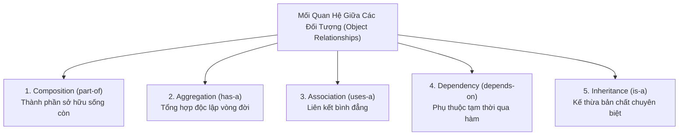

# 23.1 — Tổng Quan Về Mối Quan Hệ Giữa Các Đối Tượng (Object Relationships)

---

## 🎯 Mục Tiêu Bài Học
- Hiểu được tầm quan trọng của việc mô hình hóa mối quan hệ giữa các đối tượng trong lập trình hướng đối tượng (OOP).
- Phân biệt 5 loại quan hệ cốt lõi: **Thành phần sở hữu (Composition)**, **Tổng hợp (Aggregation)**, **Liên kết (Association)**, **Phụ thuộc (Dependency)**, và **Kế thừa (Inheritance)**.
- Nắm vững các thuật ngữ chuẩn quốc tế: *part-of*, *has-a*, *uses-a*, *depends-on*, *is-a*.
- Định hướng kiến trúc phần mềm linh hoạt, dễ mở rộng và tái sử dụng mã nguồn.

---

## 1. Mối Quan Hệ Giữa Các Đối Tượng Trong Thế Giới Thực Và Lập Trình

Thế giới tự nhiên xung quanh chúng ta là một mạng lưới phức tạp gồm các thực thể liên kết với nhau theo các quy tắc và thứ bậc chặt chẽ. Khi bạn quan sát một chiếc xe hơi, bạn nhận thấy nó được cấu thành từ động cơ, bánh xe và khung gầm. Bạn biết rằng nếu chiếc xe bị nghiền nát thành phế liệu, động cơ gắn trong nó cũng bị hủy hoại. Nhưng người lái xe thì khác: người lái xe chỉ tạm thời điều khiển chiếc xe, và khi chiếc xe dừng hoạt động, người lái xe vẫn tồn tại độc lập.

Trong lập trình hướng đối tượng (C++ OOP), các lớp (classes) và đối tượng (objects) không hoạt động đơn độc. Giá trị thực sự của phần mềm xuất hiện khi các đối tượng tương tác, chứa đựng hoặc kế thừa lẫn nhau.

---

## 2. Bảng Phân Loại Các Mối Quan Hệ Trong C++

Dưới đây là ma trận phân biệt chi tiết 5 mối quan hệ nền tảng:

| Loại Quan Hệ | Thuật Ngữ Gốc | Kiểu Quan Hệ | Ràng Buộc Vòng Đời (Lifetime) | Cơ Chế Cài Đặt Trong C++ |
| :--- | :--- | :--- | :--- | :--- |
| **Composition** | Thành phần sở hữu | **part-of** | Chặt chẽ (Cha hủy $\rightarrow$ Con hủy) | Thành viên kiểu giá trị trực tiếp (`Member m;`) |
| **Aggregation** | Tổng hợp | **has-a** | Độc lập (Con tồn tại ngoài Cha) | Con trỏ hoặc tham chiếu (`Member*`, `std::reference_wrapper`) |
| **Association** | Liên kết | **uses-a** | Độc lập hoàn toàn (Hai bên ngang hàng) | Con trỏ, tham chiếu hoặc mã định danh ID |
| **Dependency** | Phụ thuộc | **depends-on** | Tạm thời (Chỉ trong phạm vi gọi hàm) | Tham số truyền vào hàm, biến cục bộ |
| **Inheritance** | Kế thừa | **is-a** | Tuyệt đối (Con LÀ một dạng của Cha) | Cú pháp kế thừa `: public Base` |

---

## 3. Ý Nghĩa Kỹ Thuật Khi Lựa Chọn Quan Hệ

Việc lựa chọn sai mối quan hệ là nguyên nhân hàng đầu dẫn đến kiến trúc "mì ăn liền" (spaghetti code), thắt chặt liên kết không cần thiết (tight coupling), gây khó khăn cho việc viết Unit Test và bảo trì mã nguồn.

::: tip Nguyên Tắc Thiết Kế Vàng (Gang of Four)
**"Favor object composition over class inheritance"** (Hãy ưu tiên sử dụng Thành phần sở hữu hơn là Kế thừa). 
Kế thừa tạo ra mối liên kết rất cứng nhắc giữa lớp cha và lớp con. Trong khi đó, việc kết hợp các đối tượng độc lập (Composition/Aggregation) giúp mã nguồn mềm dẻo, dễ thay thế và giảm thiểu rủi ro lan truyền lỗi.
:::

---

## 4. Câu Hỏi Kiểm Tra Hiểu Biết (Quiz)

### Câu hỏi 1:
Mối quan hệ giữa "Một cuốn sách" và "Các trang sách" thuộc loại nào? Nếu cuốn sách bị đốt cháy, các trang sách có còn tồn tại không?
`
`
`
``<b>`Xem lời giải

**Đáp án**: Đây là quan hệ **Composition (part-of)**. Các trang sách là một phần không thể tách rời của cuốn sách. Khi cuốn sách bị tiêu hủy, các trang sách cấu thành nó cũng bị tiêu hủy theo.

### Câu hỏi 2:
Mối quan hệ giữa "Giáo viên" và "Khoa/Bộ môn trường đại học" là gì?
`
`
`
``<b>`Xem lời giải

**Đáp án**: Đây là quan hệ **Aggregation (has-a)**. Khoa đại học *có* các giáo viên, nhưng giáo viên tồn tại độc lập với khoa. Nếu khoa đó giải thể, giáo viên vẫn tồn tại và có thể chuyển sang khoa khác hoặc trường khác công tác.

---

## 5. Tổng Kết
Trong các bài tiếp theo của Chương 23, chúng ta sẽ lần lượt mổ xẻ mã nguồn, kiến trúc bộ nhớ RAM và các cạm bẫy thực tế của từng loại quan hệ này.
