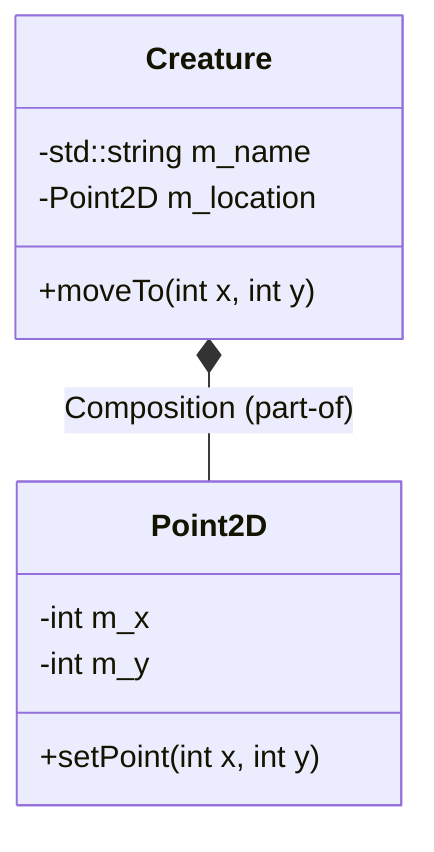

# 23.2 — Thành Phần Sở Hữu (Composition)

---

## 🎯 Mục Tiêu Bài Học
- Hiểu rõ bản chất quan hệ **Composition (part-of)** trong C++.
- Nắm vững cơ chế cấp phát bộ nhớ liền kề (Contiguous Memory Layout) khi một đối tượng chứa trực tiếp đối tượng khác.
- Thành thạo việc sử dụng **Danh sách khởi tạo thành viên (Member Initializer List)** để khởi tạo các đối tượng con.
- Hiểu quy tắc vòng đời sống còn (Lifetime Dependency): Đối tượng con sinh ra cùng cha và chết cùng cha.

---

## 1. Bản Chất Của Quan Hệ Composition

Quan hệ **Composition (Thành phần sở hữu)** là mối quan hệ phức hợp chặt chẽ nhất giữa hai đối tượng. Để một mối quan hệ được coi là Composition, nó phải thỏa mãn 3 tiêu chí bắt buộc:

1. **Quan hệ bộ phận (part-of)**: Đối tượng con là một thành phần không thể tách rời của đối tượng cha.
2. **Một chủ sở hữu duy nhất (Exclusive ownership)**: Đối tượng con tại một thời điểm chỉ thuộc về đúng một đối tượng cha.
3. **Vòng đời đồng nhất (Coincident lifetime)**: Đối tượng con được tạo ra khi đối tượng cha được tạo ra, và đối tượng con tự động bị hủy diệt khi đối tượng cha kết thúc vòng đời.



---

## 2. Trực Quan Hóa Cấu Trúc Bộ Nhớ RAM

Khi một lớp chứa trực tiếp một thành viên kiểu lớp khác (không dùng con trỏ hay tham chiếu), trình biên dịch sẽ nhúng trực tiếp toàn bộ dữ liệu của đối tượng con vào bên trong không gian bộ nhớ của đối tượng cha.

```
VÙNG NHỚ CỦA ĐỐI TƯỢNG Creature TRÊN STACK:
+-------------------------------------------------------------+
| Creature::m_name (std::string: 32 bytes)                   |
+-------------------------------------------------------------+
| Creature::m_location (Point2D: 8 bytes)                     |
|   +-----------------------+-----------------------+         |
|   | int m_x (4 bytes)     | int m_y (4 bytes)     |         |
|   +-----------------------+-----------------------+         |
+-------------------------------------------------------------+
Tổng kích thước = sizeof(std::string) + sizeof(Point2D) (+ padding nếu có)
```

::: tip Ưu Điểm Tuyệt Đối Về Hiệu Năng
Do các biến thành viên nằm liền kề nhau trong bộ nhớ (Cache locality cực cao), CPU khi nạp đối tượng cha vào L1/L2 Cache sẽ nạp luôn cả đối tượng con. Không phát sinh chi phí phân mảnh bộ nhớ Heap hay trỏ gián tiếp qua con trỏ!
:::

---

## 3. Cài Đặt Mã Nguồn Hoàn Chỉnh

Hãy xem xét ví dụ một sinh vật `Creature` sở hữu tọa độ `Point2D`:

```cpp
#include <iostream>
#include <string>
#include <string_view>

class Point2D
{
private:
    int m_x{ 0 };
    int m_y{ 0 };

public:
    Point2D() = default;
    Point2D(int x, int y) : m_x{ x }, m_y{ y }
    {
        std::cout << "Point2D (" << m_x << ", " << m_y << ") duoc tao.\n";
    }

    ~Point2D()
    {
        std::cout << "Point2D (" << m_x << ", " << m_y << ") bi huy.\n";
    }

    void setPoint(int x, int y)
    {
        m_x = x;
        m_y = y;
    }

    int getX() const { return m_x; }
    int getY() const { return m_y; }
};

class Creature
{
private:
    std::string m_name;
    Point2D m_location; // Composition: Point2D la mot phan cua Creature

public:
    Creature(std::string_view name, const Point2D& location)
        : m_name{ name }, m_location{ location }
    {
        std::cout << "Sinh vat " << m_name << " xuat hien tai toa do!\n";
    }

    ~Creature()
    {
        std::cout << "Sinh vat " << m_name << " bi tieu diet!\n";
    }

    void moveTo(int newX, int newY)
    {
        m_location.setPoint(newX, newY);
    }

    void report() const
    {
        std::cout << m_name << " dang o toa do: (" 
                  << m_location.getX() << ", " << m_location.getY() << ")\n";
    }
};

int main()
{
    std::cout << "=== BAT DAU KHOI LENH ===\n";
    {
        Creature monster{ "Rong Lua", Point2D{ 10, 25 } };
        monster.report();
        monster.moveTo(50, 100);
        monster.report();
    } // Tai day monster roi scope, bi huy tu dong
    std::cout << "=== KET THUC KHOI LENH ===\n";

    return 0;
}
```

### Kết quả thực thi:
```text
=== BAT DAU KHOI LENH ===
Point2D (10, 25) duoc tao.
Sinh vat Rong Lua xuat hien tai toa do!
Point2D (10, 25) bi huy.
Rong Lua dang o toa do: (10, 25)
Rong Lua dang o toa do: (50, 100)
Sinh vat Rong Lua bi tieu diet!
Point2D (50, 100) bi huy.
=== KET THUC KHOI LENH ===
```

::: warning Thứ Tự Khởi Tạo Và Hủy Bỏ
1. **Khởi tạo**: Các đối tượng thành phần con (`m_location`) luôn được khởi tạo **TRƯỚC**, sau đó mới thực thi thân Constructor của đối tượng cha (`Creature`).
2. **Hủy diệt**: Đối tượng cha (`Creature`) thực thi Destructor **TRƯỚC**, sau đó các đối tượng thành phần con (`m_location`) mới bị hủy theo thứ tự ngược lại.
:::

---

## 4. Khi Nào Nên Sử Dụng Composition?

Hãy áp dụng quan hệ Composition khi:
- Thành phần con không có ý nghĩa tồn tại độc lập nếu thiếu đối tượng cha.
- Bạn muốn quản lý tài nguyên tự động theo triết lý **RAII**: Khi cha bị hủy, toàn bộ con tự động giải phóng sạch sẽ mà không bao giờ sợ rò rỉ bộ nhớ (Memory Leak).
- Thiết kế hệ thống đơn giản, an toàn và trực quan.

---

## 5. Quiz & Bài Tập

### Câu hỏi:
Lớp `Car` sở hữu 4 đối tượng kiểu `Tire`. Nếu đối tượng `Car` được cấp phát động trên Heap (`Car* car = new Car;`), thì 4 đối tượng `Tire` nằm trên vùng nhớ nào (Stack hay Heap)?
`<details>`
`<summary>``<b>`Xem lời giải

**Đáp án**: Chúng nằm trên **Heap**! Vì trong Composition, đối tượng con được nhúng trực tiếp vào không gian bộ nhớ của đối tượng cha. Nếu đối tượng cha nằm trên Heap, thì toàn bộ các thành viên của nó cũng nằm trên Heap cùng một khối bộ nhớ liền mạch.

