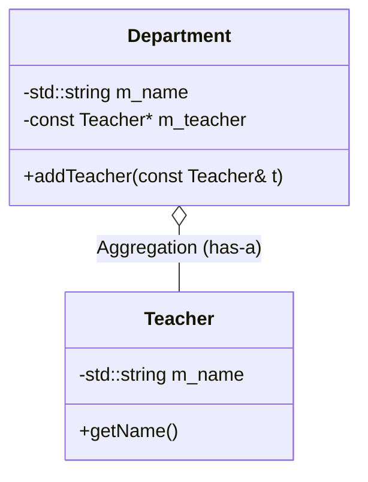

# 23.3 — Quan Hệ Tổng Hợp (Aggregation)

---

## 🎯 Mục Tiêu Bài Học
- Hiểu rõ bản chất quan hệ **Aggregation (has-a)** và sự khác biệt then chốt so với Composition.
- Nắm vững cách quản lý đối tượng thành viên tồn tại độc lập thông qua con trỏ thô, con trỏ thông minh, hoặc `std::reference_wrapper`.
- Nhận diện và phòng tránh cạm bẫy **Con trỏ lơ lửng (Dangling Pointer)** khi đối tượng thành viên bị hủy trước lớp chứa nó.

---

## 1. Bản Chất Của Quan Hệ Aggregation

**Aggregation (Tổng hợp)** là mối quan hệ yếu hơn Composition. Để một mối quan hệ là Aggregation, nó phải thỏa mãn các điều kiện:

1. **Quan hệ sở hữu lỏng lẻo (has-a)**: Đối tượng A có đối tượng B, nhưng B không phải là một phần thể xác của A.
2. **Vòng đời độc lập (Independent lifetime)**: Đối tượng con được tạo ra **trước** đối tượng cha, và khi đối tượng cha bị hủy, đối tượng con **vẫn tiếp tục tồn tại bình thường**.
3. **Có thể chia sẻ quyền sở hữu (Shared)**: Nhiều đối tượng cha có thể cùng tham chiếu tới một đối tượng con.



---

## 2. So Sánh Chi Tiết: Composition vs Aggregation

| Đặc Tính | Composition (Thành Phần Sở Hữu) | Aggregation (Tổng Hợp) |
| :--- | :--- | :--- |
| **Bản chất** | *part-of* (một phần thể xác) | *has-a* (sở hữu/liên kết độc lập) |
| **Vòng đời** | Phụ thuộc tuyệt đối (Cùng sinh cùng tử) | Độc lập (Con sống sót khi Cha chết) |
| **Quyền sở hữu** | Độc quyền (Exclusive) | Không sở hữu hoặc chia sẻ (Shared) |
| **Cài đặt C++** | Biến giá trị thông thường (`Type m_var;`) | Con trỏ hoặc tham chiếu (`Type*`, `Type&`) |
| **Quản lý hủy** | Cha tự động giải phóng con | Cha **KHÔNG ĐƯỢC** delete con |

---

## 3. Cài Đặt Mã Nguồn C++ Chuẩn Xác

Trong C++, vì tham chiếu (`&`) không thể gán lại sau khi khởi tạo và không thể lưu trực tiếp trong các container như `std::vector`, giải pháp hiện đại chuẩn C++11 trở lên là sử dụng **con trỏ** hoặc **`std::reference_wrapper`** (trong thư viện `<functional>`).

```cpp
#include <iostream>
#include <string>
#include <string_view>
#include <vector>
#include <functional> // std::reference_wrapper

class Teacher
{
private:
    std::string m_name;

public:
    Teacher(std::string_view name) : m_name{ name }
    {
        std::cout << "Giao vien " << m_name << " duoc tao.\n";
    }

    ~Teacher()
    {
        std::cout << "Giao vien " << m_name << " bi huy.\n";
    }

    std::string_view getName() const { return m_name; }
};

class Department
{
private:
    std::string m_name;
    // Dung std::reference_wrapper de luu danh sach tham chieu an toan
    std::vector<std::reference_wrapper<const Teacher>> m_teachers;

public:
    Department(std::string_view name) : m_name{ name } {}

    ~Department()
    {
        std::cout << "Khoa " << m_name << " bi giai the! (Nhung giao vien van an toan)\n";
    }

    void addTeacher(const Teacher& teacher)
    {
        m_teachers.push_back(teacher);
    }

    void showTeachers() const
    {
        std::cout << "Danh sach giang vien Khoa " << m_name << ":\n";
        for (const auto& teacherRef : m_teachers)
        {
            std::cout << " - " << teacherRef.get().getName() << '\n';
        }
    }
};

int main()
{
    // 1. Giao vien duoc tao truoc, doc lap voi Khoa
    Teacher t1{ "Thay Ba - Toan Cao Cap" };
    Teacher t2{ "Co Hoa - Lap Trinh C++" };

    std::cout << "--- Mo Khoa Cong Nghe Thong Tin ---\n";
    {
        Department cntt{ "Cong Nghe Thong Tin" };
        cntt.addTeacher(t1);
        cntt.addTeacher(t2);
        cntt.showTeachers();
    } // Tai day Khoa cntt bi huy

    std::cout << "--- Sau khi Khoa giai the ---\n";
    std::cout << "Giao vien van con song: " << t1.getName() << " va " << t2.getName() << '\n';

    return 0;
}
```

### Kết quả thực thi:
```text
Giao vien Thay Ba - Toan Cao Cap duoc tao.
Giao vien Co Hoa - Lap Trinh C++ duoc tao.
--- Mo Khoa Cong Nghe Thong Tin ---
Danh sach giang vien Khoa Cong Nghe Thong Tin:
 - Thay Ba - Toan Cao Cap
 - Co Hoa - Lap Trinh C++
Khoa Cong Nghe Thong Tin bi giai the! (Nhung giao vien van an toan)
--- Sau khi Khoa giai the ---
Giao vien van con song: Thay Ba - Toan Cao Cap va Co Hoa - Lap Trinh C++
Giao vien Co Hoa - Lap Trinh C++ bi huy.
Giao vien Thay Ba - Toan Cao Cap bi huy.
```

---

## 4. Cạm Bẫy Chết Người: Dangling Pointer / Dangling Reference

::: danger Nguy Hiểm Cực Kỳ (Undefined Behavior)
Nếu đối tượng thành viên bị hủy **TRƯỚC** khi đối tượng chứa nó kết thúc vòng đời, con trỏ hoặc tham chiếu bên trong lớp chứa sẽ trỏ vào vùng nhớ rác!
:::

```cpp
Department* dept = new Department{ "Ngoai Ngu" };
{
    Teacher tempTeacher{ "Thay Tam Thoi" };
    dept->addTeacher(tempTeacher);
} // tempTeacher bi huy tai day!

// NGUY HIEM: dept van con giu tham chieu den tempTeacher da chet!
dept->showTeachers(); // UNDEFINED BEHAVIOR! Crash hoac in ky tu rac!
```

---

## 5. Quiz Kiểm Tra Kiến Thức

### Câu hỏi:
Khi nào Destructor của lớp `Department` có quyền gọi lệnh `delete` lên con trỏ giáo viên?
`<details>`
`<summary>``<b>`Xem lời giải</b></summary>

**Đáp án**: **KHÔNG BAO GIỜ!** Trong quan hệ Aggregation, lớp cha không sở hữu vòng đời của đối tượng con. Nếu Destructor của `Department` tự ý `delete` giáo viên, sẽ xảy ra lỗi **Double Free** hoặc làm sập chương trình khi các đối tượng khác đang sử dụng chung giáo viên đó.
</details>
