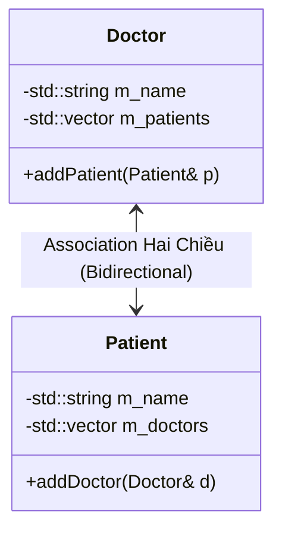

# 23.4 — Quan Hệ Liên Kết (Association)

---

## 🎯 Mục Tiêu Bài Học
- Hiểu rõ bản chất quan hệ **Association (uses-a)** giữa các đối tượng ngang hàng.
- Phân biệt giữa liên kết **Một chiều (Unidirectional)** và **Hai chiều (Bidirectional)**.
- Nắm bắt giải pháp xử lý **Phụ thuộc vòng (Circular Dependency)** bằng Khai báo tiền tiến (**Forward Declaration**).

---

## 1. Bản Chất Quan Hệ Association

Quan hệ **Association (Liên kết)** mô tả mối quan hệ giữa hai lớp độc lập hoàn toàn, trong đó không có bên nào sở hữu hay làm cha của bên nào.
- Chúng là các thực thể ngang hàng (*peer-to-peer*).
- Cả hai đều có vòng đời riêng biệt do bên ngoài quản lý.
- Mối quan hệ này biểu thị động từ "sử dụng", "làm việc cùng" (*uses-a* hoặc *works-with*).

Ví dụ kinh điển: Mối quan hệ giữa **Bác sĩ (Doctor)** và **Bệnh nhân (Patient)**.
- Một bác sĩ có thể khám cho nhiều bệnh nhân.
- Một bệnh nhân có thể có nhiều bác sĩ phụ trách.
- Bác sĩ nghỉ việc không làm bệnh nhân chết. Bệnh nhân xuất viện không làm bác sĩ bị sa thải.



---

## 2. Thách Thức Kỹ Thuật: Circular Dependency

Khi Bác sĩ cần biết thông tin Bệnh nhân, và Bệnh nhân cũng cần biết thông tin Bác sĩ, hai tệp header sẽ nảy sinh tình trạng phụ thuộc lẫn nhau:

```cpp
// Doctor.h include Patient.h
// Patient.h include Doctor.h --> LOI BIEN DICH VO TAN!
```

### Giải pháp chuẩn mực: Forward Declaration
Chúng ta khai báo trước tên lớp `class Patient;` trong `Doctor.h`, và chỉ định nghĩa chi tiết trong tệp `.cpp`.

```cpp
#include <iostream>
#include <string>
#include <string_view>
#include <vector>

// Forward declaration
class Patient;

class Doctor
{
private:
    std::string m_name;
    std::vector<std::reference_wrapper<const Patient>> m_patients;

public:
    Doctor(std::string_view name) : m_name{ name } {}

    std::string_view getName() const { return m_name; }

    void addPatient(const Patient& patient);
    void showPatients() const;
};

class Patient
{
private:
    std::string m_name;
    std::vector<std::reference_wrapper<const Doctor>> m_doctors;

public:
    Patient(std::string_view name) : m_name{ name } {}

    std::string_view getName() const { return m_name; }

    void addDoctor(const Doctor& doctor)
    {
        m_doctors.push_back(doctor);
    }

    void showDoctors() const
    {
        std::cout << "Benh nhan " << m_name << " dang duoc dieu tri boi:\n";
        for (const auto& docRef : m_doctors)
        {
            std::cout << " - Bac si: " << docRef.get().getName() << '\n';
        }
    }
};

// Trien khai phuong thuc cua Doctor sau khi Patient da duoc dinh nghia day du
void Doctor::addPatient(const Patient& patient)
{
    m_patients.push_back(patient);
}

void Doctor::showPatients() const
{
    std::cout << "Bac si " << m_name << " dang theo doi danh sach benh nhan:\n";
    for (const auto& patientRef : m_patients)
    {
        std::cout << " - Benh nhan: " << patientRef.get().getName() << '\n';
    }
}

int main()
{
    Doctor docMinh{ "BS. Nguyen Van Minh" };
    Doctor docLan{ "BS. Tran Thi Lan" };

    Patient benhNhanAn{ "Nguyen Van An" };
    Patient benhNhanBinh{ "Le Van Binh" };

    // Thiet lap lien ket 2 chieu
    docMinh.addPatient(benhNhanAn);
    benhNhanAn.addDoctor(docMinh);

    docMinh.addPatient(benhNhanBinh);
    benhNhanBinh.addDoctor(docMinh);

    docLan.addPatient(benhNhanAn);
    benhNhanAn.addDoctor(docLan);

    std::cout << "================================\n";
    docMinh.showPatients();
    std::cout << "================================\n";
    benhNhanAn.showDoctors();

    return 0;
}
```

---

## 3. Quản Lý Liên Kết Gián Tiếp Qua ID (Id-based Association)

Trong các ứng dụng cơ sở dữ liệu lớn (Database), việc lưu trữ con trỏ trực tiếp giữa hai đối tượng rất dễ gây lỗi đồng bộ khi dữ liệu thay đổi. Cách tiếp cận chuyên nghiệp hơn là sử dụng **Mã định danh duy nhất (ID)**:

```cpp
class Patient
{
private:
    int m_id;
    std::string m_name;
    std::vector<int> m_doctorIds; // Luu ID thay vi con tro
};
```
Mô hình này giúp tách rời hoàn toàn liên kết bộ nhớ, cực kỳ thích hợp cho lập trình mạng (Networking) và lưu trữ dữ liệu (Persistence).

---

## 4. Quiz

### Câu hỏi:
Sự khác biệt căn bản giữa Aggregation và Association là gì?
`<details>`
`<summary>``<b>`Xem lời giải</b></summary>

**Đáp án**: 
- **Aggregation** thể hiện mối quan hệ "sở hữu không chặt chẽ" (*whole/part* hay *has-a*), tức có một thực thể đóng vai trò là "vỏ chứa" hoặc "chủ quản" của thực thể kia (như Khoa và Giáo viên).
- **Association** thể hiện mối quan hệ liên kết ngang hàng bình đẳng (*peer-to-peer*), không bên nào chứa hay quản lý bên nào (như Bác sĩ và Bệnh nhân).
</details>
