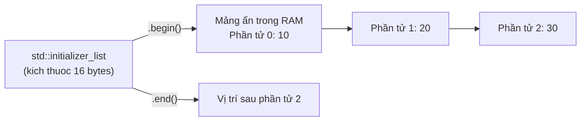

# 23.7 — Khởi Tạo Danh Sách Với `std::initializer_list` (C++11)

---

## 🎯 Mục Tiêu Bài Học
- Hiểu cơ chế hoạt động bên dưới của `std::initializer_list` trong C++11.
- Tích hợp Constructor nhận `std::initializer_list` vào lớp Container tự tạo.
- Nắm vững cạm bẫy: Trình biên dịch ưu tiên tối thượng `std::initializer_list` khi dùng cặp ngoặc nhọn `{}`.

---

## 1. Sự Cần Thiết Của `std::initializer_list`

Trước C++11, việc khởi tạo một container với các giá trị ban đầu rất cồng kềnh:
```cpp
// Thoi ky C++03: Phai chen tung phan tu mot
IntArray arr(3);
arr[0] = 10;
arr[1] = 20;
arr[2] = 30;
```

C++11 giới thiệu lớp mẫu `std::initializer_list<T>` trong header `<initializer_list>`, cho phép chúng ta khởi tạo trực quan và thanh lịch:
```cpp
IntArray arr{ 10, 20, 30, 40, 50 }; // C++11 Uniform Initialization
```

---

## 2. Bản Chất Bộ Nhớ Của `std::initializer_list`

Khi trình biên dịch nhìn thấy danh sách `{ 10, 20, 30 }`, nó thực hiện:
1. Tạo một mảng ẩn các phần tử kiểu `const T` trên Stack hoặc vùng dữ liệu chỉ đọc (Read-only data segment).
2. Tạo một đối tượng `std::initializer_list<T>` bọc lấy hai con trỏ: `begin()` trỏ tới phần tử đầu tiên và `end()` trỏ tới vị trí sau phần tử cuối cùng.
3. Truyền đối tượng nhỏ gọn này (thường chỉ 16 bytes gồm 2 con trỏ) vào Constructor.



---

## 3. Tích Hợp Vào Lớp `IntArray`

```cpp
#include <iostream>
#include <initializer_list>
#include <algorithm> // std::copy

class IntArray
{
private:
    int m_length{ 0 };
    int* m_data{ nullptr };

public:
    IntArray() = default;

    explicit IntArray(int length) : m_length{ length }
    {
        if (length > 0)
            m_data = new int[length]{};
    }

    // CONSTRUCTOR NHAN std::initializer_list
    IntArray(std::initializer_list<int> list)
        : IntArray(static_cast<int>(list.size())) // Goi constructor uy quyen (Delegating constructor)
    {
        int count{ 0 };
        for (auto element : list)
        {
            m_data[count] = element;
            ++count;
        }
    }

    ~IntArray()
    {
        delete[] m_data;
    }

    int getLength() const { return m_length; }
    int operator[](int index) const { return m_data[index]; }
};

int main()
{
    // Khoi tao mang de dang nhu cac kieu nguyen thuy!
    IntArray array{ 5, 4, 3, 2, 1, 99, 100 };

    std::cout << "Cac phan tu trong array: ";
    for (int i = 0; i < array.getLength(); ++i)
    {
        std::cout << array[i] << ' ';
    }
    std::cout << '\n';

    return 0;
}
```

---

## 4. Cạm Bẫy Kinh Điển: `v{5}` vs `v(5)` Trong `std::vector`

::: danger Cạm Bẫy Cực Kỳ Phổ Biến Của Lập Trình Viên C++
Khi một lớp có cả Constructor nhận tham số thông thường và Constructor nhận `std::initializer_list`, việc dùng ngoặc nhọn `{}` sẽ luôn được compiler **ƯU TIÊN TUYỆT ĐỐI** nếu các phần tử có thể chuyển đổi kiểu về kiểu của initializer_list!
:::

```cpp
#include <vector>
#include <iostream>

int main()
{
    // Goi Constructor (int size): Tao vector co 5 phan tu, tat ca bang 0
    std::vector<int> a(5);
    std::cout << "a.size() = " << a.size() << " | a[0] = " << a[0] << '\n'; 
    // Output: size = 5, a[0] = 0

    // Goi Constructor (initializer_list<int>): Tao vector co dung 1 phan tu la so 5!
    std::vector<int> b{5};
    std::cout << "b.size() = " << b.size() << " | b[0] = " << b[0] << '\n'; 
    // Output: size = 1, b[0] = 5

    return 0;
}
```

---

## 5. Quiz

### Câu hỏi:
Có thể sửa đổi các phần tử bên trong `std::initializer_list<T>` được không (ví dụ: `*list.begin() = 10;`)?
`<details>`
`<summary>``<b>`Xem lời giải</b></summary>

**Đáp án**: **HOÀN TOÀN KHÔNG!** Các phần tử trong `std::initializer_list<T>` luôn có thuộc tính `const`. Trình biên dịch cấm tuyệt đối mọi hành vi sửa đổi giá trị bên trong danh sách này để đảm bảo tính an toàn và cho phép đặt mảng dữ liệu vào vùng nhớ chỉ đọc (Read-only memory).
</details>
