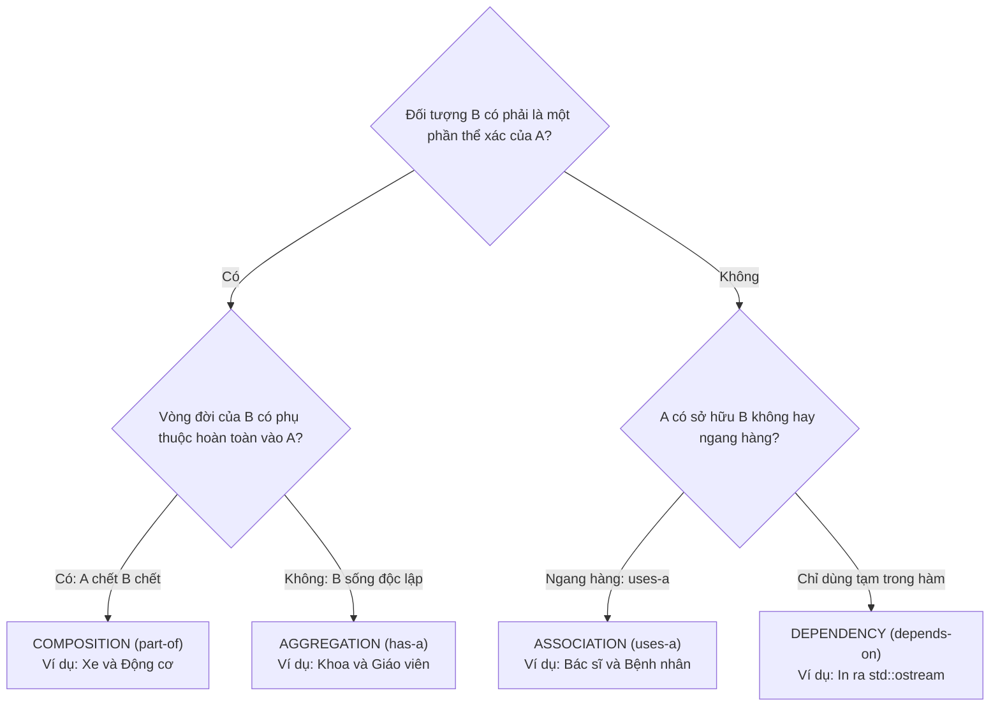

# 23.x — Tổng Kết Chương 23 & Bài Kiểm Tra Toàn Diện

---

## 🎯 Mục Tiêu
- Khái quát toàn bộ bức tranh về mối quan hệ giữa các đối tượng trong C++.
- Hệ thống hóa bảng tra cứu nhanh giúp bạn ra quyết định thiết kế kiến trúc phần mềm chuẩn xác.
- Vượt qua bộ câu hỏi trắc nghiệm và bài tập thực hành thiết kế OOP hoàn chỉnh.

---

## 1. Bảng Tổng Hợp Các Mối Quan Hệ Đối Tượng



---

## 2. Bài Kiểm Tra Toàn Diện (Comprehensive Quiz)

### Câu hỏi 1:
Mỗi trường hợp sau đây tương ứng với mối quan hệ nào (Composition, Aggregation, Association, Dependency)?
1. Một chiếc máy tính xách tay và bo mạch chủ (Motherboard) gắn chặt bên trong nó.
2. Một thư viện và các cuốn sách có thể mượn đem về nhà.
3. Một người lập trình viên và bàn phím máy tính anh ấy đang gõ.
4. Một hàm tính căn bậc hai `Math::sqrt` nhận vào một số `double`.

<details>
<summary><b>Xem lời giải</b></summary>

1. **Composition (part-of)**: Bo mạch chủ là thành phần sống còn của máy tính.
2. **Aggregation (has-a)**: Thư viện chứa sách, nhưng sách mượn ra ngoài vẫn tồn tại độc lập.
3. **Association (uses-a)**: Lập trình viên và bàn phím là 2 thực thể độc lập tương tác với nhau.
4. **Dependency (depends-on)**: Hàm toán học chỉ nhận dữ liệu tham số để tính toán tạm thời.
</details>

### Câu hỏi 2:
Hãy viết một chương trình C++ hoàn chỉnh mô phỏng mối quan hệ:
- Một lớp `Monster` (Quái vật) có tên (`std::string`) và máu (`int`).
- Một lớp `Weapon` (Vũ khí) có tên và sát thương (`int`).
- Quái vật có thể nhặt một vũ khí và sử dụng nó để tấn công. Vũ khí tồn tại độc lập với quái vật (Khi quái vật chết, vũ khí rơi ra đất và không bị hủy).
- Xác định đây là mối quan hệ gì và viết code minh họa.

<details>
<summary><b>Xem lời giải</b></summary>

Đây là quan hệ **Aggregation (has-a)**: Quái vật *có* vũ khí, nhưng không sở hữu vòng đời của vũ khí.

```cpp
#include <iostream>
#include <string>
#include <string_view>

class Weapon
{
private:
    std::string m_name;
    int m_damage{ 0 };

public:
    Weapon(std::string_view name, int damage)
        : m_name{ name }, m_damage{ damage } {}

    std::string_view getName() const { return m_name; }
    int getDamage() const { return m_damage; }
};

class Monster
{
private:
    std::string m_name;
    int m_hp{ 100 };
    const Weapon* m_weapon{ nullptr }; // Aggregation qua con trỏ

public:
    Monster(std::string_view name, int hp)
        : m_name{ name }, m_hp{ hp } {}

    void equipWeapon(const Weapon& weapon)
    {
        m_weapon = &weapon;
    }

    void attack() const
    {
        if (m_weapon)
        {
            std::cout << m_name << " tan cong bang " << m_weapon->getName() 
                      << " gay " << m_weapon->getDamage() << " sat thuong!\n";
        }
        else
        {
            std::cout << m_name << " tan cong bang tay khong gay 1 sat thuong!\n";
        }
    }
};

int main()
{
    // Vu khi ton tai doc lap
    Weapon legendarySword{ "Thanh Guom Diet Quy", 999 };

    {
        Monster orc{ "Chua Te Orc", 500 };
        orc.equipWeapon(legendarySword);
        orc.attack();
    } // Quai vat orc bi tieu diet tai day

    // Vu khi van nguyen ven sau khi quai vat chet!
    std::cout << "Vu khi van con tren mat dat: " << legendarySword.getName() 
              << " voi sat thuong: " << legendarySword.getDamage() << '\n';

    return 0;
}
```
</details>

---

## 3. Lời Kết Chương 23
Bạn đã làm chủ toàn bộ các mối quan hệ cấu thành hướng đối tượng. Ở Chương 24 và Chương 25 tiếp theo, chúng ta sẽ bước vào đỉnh cao của lập trình hướng đối tượng: **Tính Kế Thừa (Inheritance)** và **Hàm Ảo & Tính Đa Hình (Virtual Functions & Polymorphism)**!
