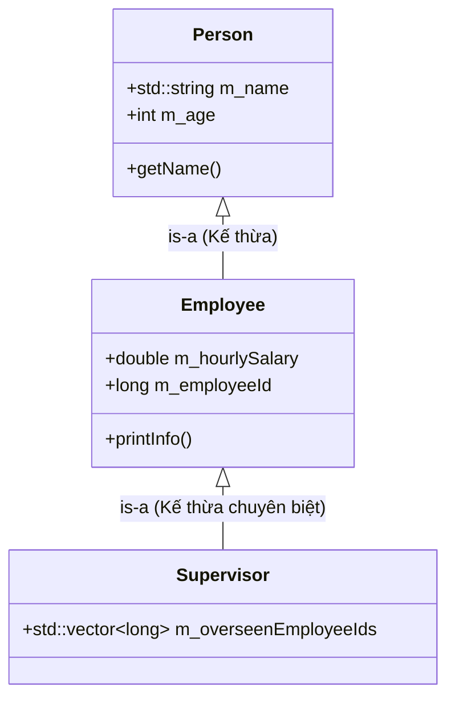

# 24.1 — Giới Thiệu Về Tính Kế Thừa (Introduction to Inheritance)

---

## 🎯 Mục Tiêu Bài Học
- Hiểu rõ bản chất quan hệ **Kế thừa (Inheritance)** và khái niệm **"is-a"** (Con LÀ một dạng của Cha).
- Phân biệt giữa quan hệ Kế thừa và quan hệ Thành phần sở hữu (Composition).
- Nhận thức giá trị tối thượng của Kế thừa: Tái sử dụng mã nguồn (Code reuse) và thiết lập hệ thống phân cấp logic.

---

## 1. Kế Thừa Là Gì?

Trong lập trình hướng đối tượng, **Kế thừa (Inheritance)** là cơ chế cho phép một lớp mới (gọi là **Lớp dẫn xuất / Derived Class** hoặc **Lớp con / Subclass**) tiếp nhận và tái sử dụng toàn bộ các thuộc tính và hành vi của một lớp đã có sẵn (gọi là **Lớp cơ sở / Base Class** hoặc **Lớp cha / Superclass**), đồng thời có thể mở rộng thêm các tính năng chuyên biệt của riêng mình.

Mối quan hệ kế thừa luôn thể hiện quan hệ **"is-a" (Là một dạng của)**:
- Táo (*Apple*) **là một** Trái cây (*Fruit*).
- Lập trình viên (*Programmer*) **là một** Nhân viên (*Employee*).
- Hình chữ nhật (*Rectangle*) **là một** Hình học (*Shape*).



---

## 2. Tại Sao Cần Kế Thừa? (Giải Quyết Vấn Đề Dư Thừa Mã)

Giả sử bạn phải xây dựng phần mềm quản lý nhân sự. Ban đầu bạn viết lớp `Person` để quản lý thông tin công dân. Sau đó công ty cần quản lý `Employee`.
Nếu không có kế thừa, bạn sẽ phải sao chép toàn bộ code của `Person` sang `Employee`:

```cpp
// THIẾT KẾ XẤU: Trùng lặp mã nguồn (Code Duplication)
class Person
{
    std::string m_name;
    int m_age;
};

class Employee
{
    std::string m_name;  // Trùng lặp!
    int m_age;           // Trùng lặp!
    double m_salary;
    long m_id;
};
```

Hậu quả:
- Nếu bạn cần sửa lỗi hoặc thêm trường dữ liệu (ví dụ: `email`), bạn phải sửa ở cả 2 nơi!
- Vi phạm nguyên lý **DRY (Don't Repeat Yourself)**.

Với **Kế thừa**, `Employee` chỉ cần kế thừa `Person` và chỉ tập trung khai báo những gì chuyên biệt của nhân viên: lương và mã nhân viên.

---

## 3. Quiz Kiểm Tra Hiểu Biết

### Câu hỏi:
Xác định xem các cặp thực thể sau đây có mối quan hệ **Kế thừa ("is-a")** hay **Thành phần ("has-a")**:
1. Xe hơi và Bánh xe.
2. Tam giác và Hình đa giác.
3. Bệnh viện và Bác sĩ.
4. Chó và Động vật có vú.

<details>
<summary><b>Xem lời giải</b></summary>

1. **has-a (Composition/Aggregation)**: Xe hơi *có* bánh xe (không phải Xe hơi là một bánh xe).
2. **is-a (Inheritance)**: Tam giác *là một* Hình đa giác.
3. **has-a (Aggregation)**: Bệnh viện *có* bác sĩ làm việc.
4. **is-a (Inheritance)**: Chó *là một* loài Động vật có vú.
</details>
