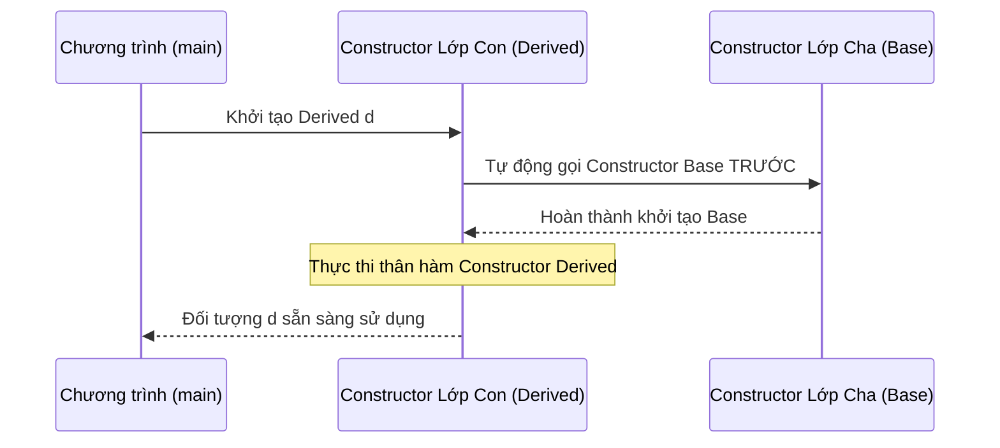

# 24.3 — Thứ Tự Khởi Tạo & Hủy Bỏ Lớp Dẫn Xuất (Order of Construction)

---

## 🎯 Mục Tiêu Bài Học
- Hiểu quy tắc bất biến: **Lớp cơ sở luôn được khởi tạo TRƯỚC lớp dẫn xuất**.
- Nắm rõ thứ tự gọi Constructor và Destructor trong chuỗi kế thừa nhiều tầng.
- Hiểu lý do tại sao C++ bắt buộc phải tuân theo thứ tự này để đảm bảo an toàn bộ nhớ.

---

## 1. Quy Tắc Khởi Tạo: Base Trước, Derived Sau

Hãy tưởng tượng bạn xây dựng một ngôi nhà 3 tầng: bạn không thể nào đổ mái tầng 2 khi chưa xây xong móng và tường tầng 1.
Trong C++, lớp dẫn xuất phụ thuộc vào các biến thành viên của lớp cơ sở. Do đó, **Lớp cơ sở bắt buộc phải được tạo lập hoàn tất trước khi lớp dẫn xuất bắt đầu chạy Constructor**.



---

## 2. Minh Họa Bằng Mã Nguồn Thực Tế

```cpp
#include <iostream>

class A
{
public:
    A() { std::cout << "1. Constructor A (Base)\n"; }
    ~A() { std::cout << "4. Destructor A (Base)\n"; }
};

class B : public A
{
public:
    B() { std::cout << "2. Constructor B (Derived tu A)\n"; }
    ~B() { std::cout << "3. Destructor B (Derived tu A)\n"; }
};

class C : public B
{
public:
    C() { std::cout << "3. Constructor C (Derived tu B)\n"; }
    ~C() { std::cout << "2. Destructor C (Derived tu B)\n"; }
};

int main()
{
    std::cout << "=== KHOI TAO DOI TUONG C ===\n";
    {
        C c;
    } // c roi scope va bi huy
    std::cout << "=== KET THUC CHUONG TRINH ===\n";

    return 0;
}
```

### Kết quả xuất ra màn hình:
```text
=== KHOI TAO DOI TUONG C ===
1. Constructor A (Base)
2. Constructor B (Derived tu A)
3. Constructor C (Derived tu B)
2. Destructor C (Derived tu B)
3. Destructor B (Derived tu A)
4. Destructor A (Base)
=== KET THUC CHUONG TRINH ===
```

::: warning Quy Tắc Đối Xứng Bất Biến
- **Thứ tự Khởi tạo (Construction)**: Từ **Gốc đến Ngọn** (Cha $\rightarrow$ Con $\rightarrow$ Cháu).
- **Thứ tự Hủy diệt (Destruction)**: Từ **Ngọn về Gốc** (Cháu $\rightarrow$ Con $\rightarrow$ Cha) — hoàn toàn tương tự nguyên lý LIFO (Last In First Out) của ngăn xếp Stack.
:::

---

## 3. Quiz

### Câu hỏi:
Tại sao Destructor của lớp con phải chạy trước Destructor của lớp cha?
<details>
<summary><b>Xem lời giải</b></summary>

**Đáp án**: Nếu Destructor của lớp cha chạy trước, các biến thành viên của lớp cha sẽ bị giải phóng. Khi đó, nếu Destructor của lớp con cần truy cập dữ liệu của lớp cha để dọn dẹp, nó sẽ truy cập vào vùng nhớ đã chết, gây lỗi nghiêm trọng (Undefined Behavior / Crash).
</details>
