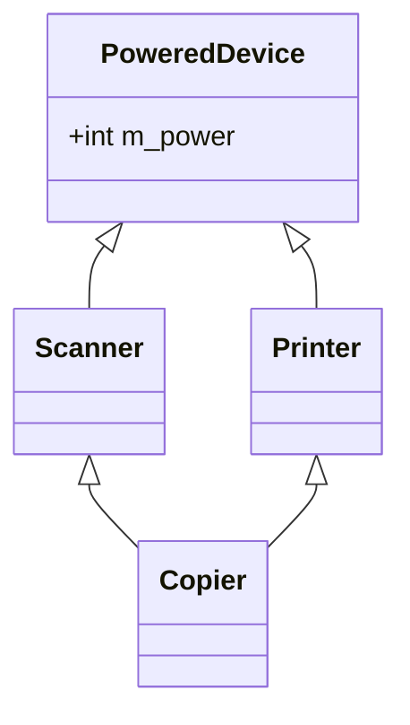

# 24.9 — Đa Kế Thừa (Multiple Inheritance) & Vấn Đề Kim Cương

---

## 🎯 Mục Tiêu Bài Học
- Hiểu cú pháp và cách thức hoạt động của **Đa kế thừa (Multiple Inheritance)** trong C++.
- Nhận thức sâu sắc cạm bẫy kinh điển: **Bài toán kim cương (The Diamond Problem)**.
- Trực quan hóa cấu trúc bộ nhớ RAM khi đa kế thừa gây dư thừa và xung đột dữ liệu.
- Giới thiệu giải pháp Kế thừa ảo (**Virtual Inheritance**).

---

## 1. Đa Kế Thừa Là Gì?

C++ là một trong số ít các ngôn ngữ mạnh mẽ cho phép một lớp con kế thừa trực tiếp từ **nhiều hơn một lớp cha**.

```cpp
#include <iostream>

class USBDevice
{
public:
    void plugUSB() { std::cout << "Cam cong USB.\n"; }
};

class WirelessDevice
{
public:
    void connectWifi() { std::cout << "Ket noi Wifi.\n"; }
};

// Smartphone ke thua ca 2 lop cha
class Smartphone : public USBDevice, public WirelessDevice
{
};

int main()
{
    Smartphone phone;
    phone.plugUSB();     // Tu USBDevice
    phone.connectWifi(); // Tu WirelessDevice
    return 0;
}
```

---

## 2. Cạm Bẫy Chí Mạng: The Diamond Problem (Bài Toán Kim Cương)

Bài toán kim cương xảy ra khi hai lớp con cùng kế thừa từ một lớp gốc, và sau đó có một lớp thứ tư kế thừa từ cả hai lớp con đó:



### Trực quan hóa cấu trúc bộ nhớ RAM của `Copier`:

```
BỐ CỤC BỘ NHỚ RAM CỦA ĐỐI TƯỢNG Copier:
+-------------------------------------------------------------+
| [PHẦN KẾ THỪA TỪ Scanner]                                   |
|   +-------------------------------------------------------+ |
|   | PoweredDevice subobject (BẢN SAO SỐ 1: m_power)       | |
|   +-------------------------------------------------------+ |
|   | Scanner members                                       | |
+-------------------------------------------------------------+
| [PHẦN KẾ THỪA TỪ Printer]                                   |
|   +-------------------------------------------------------+ |
|   | PoweredDevice subobject (BẢN SAO SỐ 2: m_power)       | |
|   +-------------------------------------------------------+ |
|   | Printer members                                       | |
+-------------------------------------------------------------+
| [PHẦN THÀNH VIÊN RIÊNG CỦA Copier]                          |
+-------------------------------------------------------------+
```

Hậu quả:
1. **Lãng phí bộ nhớ**: `Copier` mang trong mình **2 bản sao độc lập** của `PoweredDevice`!
2. **Nhập nhằng định danh (Ambiguity)**: Khi gọi `copier.m_power`, trình biên dịch lập tức báo lỗi vì không biết bạn muốn truy cập `m_power` của nhánh `Scanner` hay nhánh `Printer`!

---

## 3. Lời Giải: Virtual Base Classes (Kế Thừa Ảo)

Để giải quyết triệt để vấn đề này, C++ cung cấp cơ chế **`virtual inheritance`** (sẽ được đào sâu chi tiết ở bài 25.8). Khi khai báo `class Scanner : virtual public PoweredDevice`, C++ sẽ đảm bảo trong toàn bộ đối tượng `Copier` chỉ tồn tại duy nhất một bản sao chung của `PoweredDevice`.

---

## 4. Quiz

### Câu hỏi:
Tại sao nhiều ngôn ngữ hiện đại như Java hay C# lại cấm đa kế thừa lớp?
`<details>`
`<summary>``<b>`Xem lời giải</b></summary>

**Đáp án**: Đa kế thừa làm tăng vọt độ phức tạp của mã nguồn, dễ tạo ra nhập nhằng xung đột tên hàm và phát sinh lỗi bài toán kim cương. Java và C# chỉ cho phép kế thừa 1 lớp và thực thi nhiều Interface để tránh hoàn toàn các rủi ro kiến trúc này.
</details>
