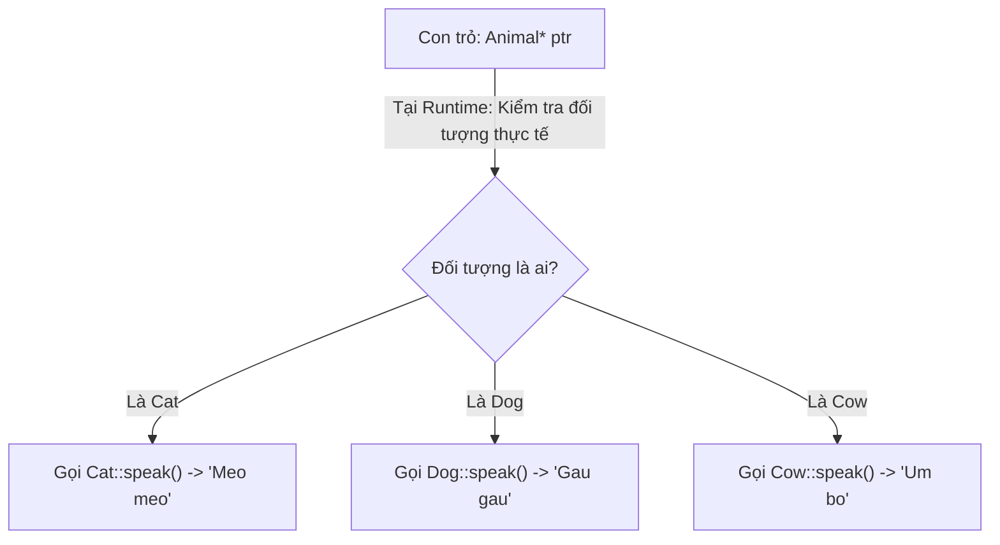

# 25.2 — Hàm Ảo & Tính Đa Hình (Virtual Functions & Polymorphism)

---

## 🎯 Mục Tiêu Bài Học
- Hiểu định nghĩa của **Hàm ảo (Virtual Function)** thông qua từ khóa `virtual`.
- Nắm vững khái niệm **Tính đa hình runtime (Runtime Polymorphism / Dynamic Dispatch)**.
- Biết cách sử dụng con trỏ hoặc tham chiếu lớp cơ sở để thực thi đa hình các hành vi chuyên biệt của lớp con.

---

## 1. Hàm Ảo (Virtual Function) Là Gì?

**Hàm ảo** là một hàm thành viên đặc biệt được khai báo với từ khóa `virtual` trong lớp cơ sở, cho phép trình biên dịch hoãn việc quyết định gọi hàm nào cho tới khi chương trình đang chạy thực tế (**Runtime / Dynamic Binding**). 

Khi một hàm ảo được gọi thông qua con trỏ hoặc tham chiếu lớp cơ sở, C++ sẽ tự động tra cứu loại đối tượng thực tế đang được trỏ tới và gọi phiên bản được ghi đè tương ứng của lớp con đó!



---

## 2. Mã Nguồn Minh Họa Tính Đa Hình Chuẩn Mực

```cpp
#include <iostream>
#include <string_view>
#include <vector>

class Animal
{
protected:
    std::string_view m_name;

public:
    Animal(std::string_view name) : m_name{ name } {}

    // KHAI BÁO HÀM ẢO BẰNG TỪ KHÓA virtual
    virtual std::string_view speak() const
    {
        return "???";
    }

    std::string_view getName() const { return m_name; }
};

class Cat : public Animal
{
public:
    Cat(std::string_view name) : Animal{ name } {}

    // Ghi đè (override) hàm ảo của lớp cha
    virtual std::string_view speak() const
    {
        return "Meo meo";
    }
};

class Dog : public Animal
{
public:
    Dog(std::string_view name) : Animal{ name } {}

    virtual std::string_view speak() const
    {
        return "Gau gau";
    }
};

// Hàm nhận tham chiếu lớp cơ sở nhưng hoạt động ĐA HÌNH tuyệt đối!
void report(const Animal& animal)
{
    std::cout << animal.getName() << " keu tieng: " << animal.speak() << '\n';
}

int main()
{
    Cat meo{ "Mimi" };
    Dog cho{ "Milu" };

    // Gọi hàm thông qua tham chiếu lớp cơ sở
    report(meo); // In ra: Mimi keu tieng: Meo meo
    report(cho); // In ra: Milu keu tieng: Gau gau

    // Lưu trữ danh sách đa hình bằng mảng con trỏ
    std::vector<const Animal*> zoo{ &meo, &cho };
    std::cout << "\n--- TIENG KEU TRONG SO THU ---\n";
    for (const auto* animal : zoo)
    {
        std::cout << animal->getName() << ": " << animal->speak() << '\n';
    }

    return 0;
}
```

---

## 3. Các Quy Tắc Quan Trọng Về Hàm Ảo

1. **Tính lan truyền tự động**: Nếu một hàm được đánh dấu là `virtual` trong lớp cơ sở, nó sẽ tự động là hàm ảo trong tất cả các lớp dẫn xuất sau này, dù bạn có viết từ khóa `virtual` ở lớp con hay không.
2. **Chữ ký hàm phải giống hệt nhau**: Hàm ở lớp con bắt buộc phải có cùng tên, cùng số lượng kiểu tham số, và cùng tính chất `const` với hàm lớp cha. Nếu sai khác dù chỉ một chi tiết nhỏ, trình biên dịch sẽ coi đó là một hàm mới độc lập (Function Overloading) chứ không phải ghi đè!
3. **Chỉ hoạt động qua con trỏ hoặc tham chiếu**: Nếu bạn truyền theo giá trị (Pass-by-value), hiện tượng **Object Slicing** sẽ xảy ra và làm mất hoàn toàn tính đa hình (chi tiết tại bài 25.9).
