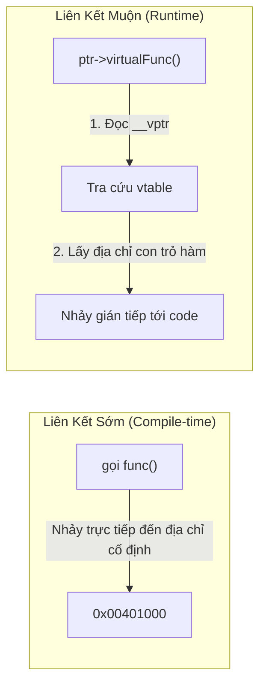

# 25.5 — Liên Kết Sớm (Early Binding) & Liên Kết Muộn (Late Binding)

---

## 🎯 Mục Tiêu Bài Học
- Phân biệt bản chất của **Liên kết sớm (Early / Static Binding)** và **Liên kết muộn (Late / Dynamic Binding)**.
- Hiểu cách thức CPU thực thi lệnh nhảy trực tiếp (`call <address>`) so với nhảy gián tiếp qua con trỏ.
- Phân tích chi phí hiệu năng (Overhead) thực tế của tính đa hình động.

---

## 1. Liên Kết Sớm (Early Binding / Static Binding)

Liên kết sớm xảy ra khi trình biên dịch (Compiler) và trình liên kết (Linker) có thể xác định chính xác địa chỉ bộ nhớ của hàm cần gọi **ngay tại thời điểm biên dịch**.

Mọi hàm thông thường, hàm quá tải (Overloading) và hàm mẫu (Templates) trong C++ đều sử dụng liên kết sớm.

```cpp
void printNumber(int x) { ... }

int main()
{
    printNumber(5); // Compiler tạo chỉ thị máy: call 0x00401120
}
```

```
Ưu điểm:
- Tốc độ thực thi tối đa (Zero runtime overhead).
- Compiler có thể dễ dàng tối ưu hóa bằng cách nhúng trực tiếp code vào (Function Inlining).
```

---

## 2. Liên Kết Muộn (Late Binding / Dynamic Binding)

Liên kết muộn xảy ra khi địa chỉ của hàm cần gọi **không thể biết trước khi biên dịch**, mà phải chờ đến khi chương trình đang chạy thực tế (Runtime) mới có thể xác định được.

Trong C++, liên kết muộn được kích hoạt thông qua:
1. **Con trỏ hàm (Function Pointers)**.
2. **Hàm ảo (Virtual Functions)**.



---

## 3. Chi Phí Hiệu Năng Của Liên Kết Động (Runtime Overhead)

Tại sao C++ không mặc định biến tất cả các hàm thành `virtual` như Java hay C#? Triết lý của C++ là: **"Zero-overhead principle: What you don't use, you don't pay for"**.

Chi phí của hàm ảo gồm có:
1. **Bộ nhớ**: Mỗi đối tượng phải mang thêm 1 con trỏ ẩn `__vptr` (8 bytes trên hệ 64-bit).
2. **Thời gian**: Mỗi lời gọi hàm ảo tốn thêm ít nhất 2 lần truy xuất bộ nhớ gián tiếp (Đọc `__vptr` $\rightarrow$ Đọc ô trong `vtable` $\rightarrow$ Gọi hàm).
3. **Cản trở tối ưu**: Trình biên dịch không thể thực hiện Inline đối với các lời gọi hàm ảo thông qua con trỏ, đồng thời làm tăng nguy cơ **Branch Misprediction** trong vi xử lý CPU.
