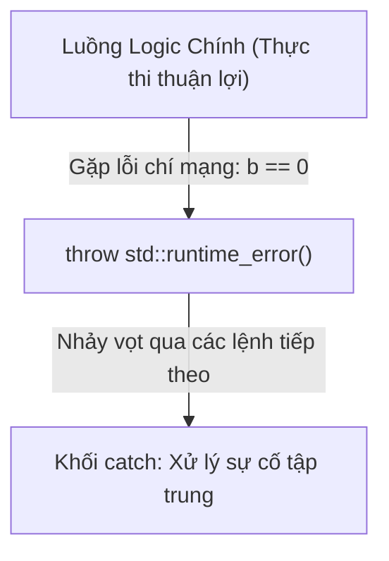

# 27.1 — Nhu Cầu Cần Ngoại Lệ (The Need for Exceptions)

---

## 🎯 Mục Tiêu Bài Học
- Nhận thức những hạn chế nghiêm trọng của cơ chế xử lý lỗi truyền thống qua Mã Lỗi (Return / Error Codes).
- Hiểu tại sao Constructor không thể dùng mã lỗi và nguy cơ tạo ra "Đối tượng xác sống" (**Zombie Objects**).
- Thấy được sự thanh lịch của Ngoại Lệ (**Exceptions**) trong việc tách rời luồng logic chính khỏi luồng xử lý lỗi.

---

## 1. Hạn Chế Của Cơ Chế Báo Lỗi Truyền Thống

Trong ngôn ngữ C và C++ thời kỳ đầu, cách thông dụng nhất để báo lỗi là trả về một giá trị đặc biệt (ví dụ `-1`, `nullptr` hoặc mã lỗi `enum`):

```cpp
// Cách tiếp cận truyền thống
int divide(int a, int b, int& result)
{
    if (b == 0)
        return -1; // Mã lỗi: Chia cho 0
    result = a / b;
    return 0;      // Thành công
}
```

Cách làm này bộc lộ 3 nhược điểm chí tử:
1. **Dễ bị lập trình viên bỏ qua**: Không có cơ chế nào ép buộc người gọi hàm phải kiểm tra giá trị trả về. Nếu họ lờ đi, chương trình sẽ tiếp tục chạy với dữ liệu sai lệch.
2. **Làm ô nhiễm luồng logic chính**: Mã nguồn bị phân mảnh bởi hàng loạt câu lệnh `if (err != 0) return err;`, khiến code cực kỳ rối rắm và khó đọc.
3. **Constructor hoàn toàn bất lực!**: Constructor **không có kiểu dữ liệu trả về**. Nếu Constructor của một đối tượng bị lỗi (ví dụ: không mở được file hoặc không kết nối được Database), nó không thể trả về mã lỗi. Kết quả là đối tượng vẫn được tạo ra ở trạng thái lỗi hỏng — một đối tượng "xác sống" (**Zombie Object**)!

---

## 2. Giải Pháp Ngoại Lệ (Exceptions)

Cơ chế ngoại lệ giải quyết triệt để vấn đề:
- Khi một hàm gặp sự cố không thể tự giải quyết, nó **ném ngoại lệ (`throw`)**.
- Luồng thực thi lập tức dừng lại, ngăn chặn việc sử dụng dữ liệu rác.
- Ngoại lệ được chuyển ngược lên ngăn xếp cho tới khi gặp một khối xử lý phù hợp (`catch`).


