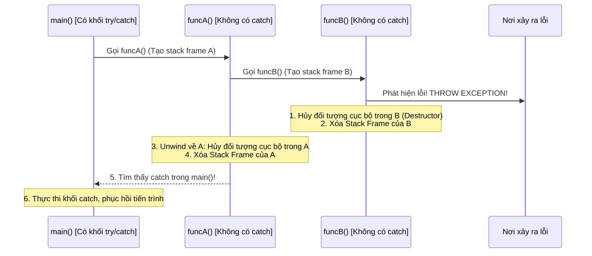

# 27.3 — Ngoại Lệ, Hàm & Cơ Chế Cuộn Ngược Ngăn Xếp (Stack Unwinding)

---

## 🎯 Mục Tiêu Bài Học
- **TRỰC QUAN HÓA TOÀN BỘ CƠ CHẾ CUỘN NGƯỢC NGĂN XẾP (STACK UNWINDING) TRONG RAM**.
- Hiểu cách C++ tự động dọn dẹp biến cục bộ và gọi Destructor theo triết lý RAII khi ngoại lệ bay xuyên qua các tầng hàm.
- **CẠM BẪY SỐNG CÒN**: Con trỏ thô (Raw Pointer) bị rò rỉ bộ nhớ khi Stack Unwind và lý do bắt buộc dùng Smart Pointer.

---

## 1. Cơ Chế Stack Unwinding Là Gì?

Khi một ngoại lệ được ném ra từ một hàm ở rất sâu bên dưới cây gọi hàm (`main -> funcA -> funcB -> funcC`), nếu hàm hiện tại không có khối `try-catch`, C++ sẽ **thoát khỏi hàm đó và cuộn ngược lên hàm cha đã gọi nó**.

Quá trình này lặp lại liên tục ngược lên đỉnh ngăn xếp cho tới khi tìm thấy một khối `catch` phù hợp. Quá trình đó được gọi là **Cuộn ngược ngăn xếp (Stack Unwinding)**.

::: tip Sức Mạnh Vô Song Của RAII Trong Stack Unwinding
Mỗi khi C++ thoát khỏi một hàm trong quá trình cuộn ngược ngăn xếp, **tất cả các đối tượng cục bộ trong Stack Frame của hàm đó BẮT BUỘC ĐƯỢC GỌI DESTRUCTOR ĐỂ GIẢI PHÓNG TÀI NGUYÊN HOÀN TOÀN TỰ ĐỘNG!**
:::

---

## 2. Trực Quan Hóa Quá Trình Stack Unwinding Trong Bộ Nhớ RAM



---

## 3. Mã Nguồn Thực Nghiệm Chứng Minh Thứ Tự Hủy Biến

```cpp
#include <iostream>

class Tracker
{
private:
    std::string m_name;

public:
    Tracker(std::string_view name) : m_name{ name }
    {
        std::cout << " [Khoi tao] " << m_name << '\n';
    }

    ~Tracker()
    {
        std::cout << " [Huy bo]   " << m_name << " (Tu dong don dep boi Stack Unwinding!)\n";
    }
};

void funcC()
{
    Tracker tC{ "Bien cuc bo tai funcC" };
    std::cout << "funcC: Nem ngoai le!\n";
    throw 404; // Nem ngoai le so nguyen
}

void funcB()
{
    Tracker tB{ "Bien cuc bo tai funcB" };
    funcC();
    std::cout << "Dong nay trong funcB KHONG BAO GIO duoc in!\n";
}

void funcA()
{
    Tracker tA{ "Bien cuc bo tai funcA" };
    funcB();
}

int main()
{
    try
    {
        funcA();
    }
    catch (int errorCode)
    {
        std::cout << "-> main() da bat ngoai le ma: " << errorCode << '\n';
    }

    return 0;
}
```

### Kết quả xuất ra:
```text
 [Khoi tao] Bien cuc bo tai funcA
 [Khoi tao] Bien cuc bo tai funcB
 [Khoi tao] Bien cuc bo tai funcC
funcC: Nem ngoai le!
 [Huy bo]   Bien cuc bo tai funcC (Tu dong don dep boi Stack Unwinding!)
 [Huy bo]   Bien cuc bo tai funcB (Tu dong don dep boi Stack Unwinding!)
 [Huy bo]   Bien cuc bo tai funcA (Tu dong don dep boi Stack Unwinding!)
-> main() da bat ngoai le ma: 404
```

---

## 4. Cạm Bẫy Sống Còn: Con Trỏ Thô & Rò Rỉ Bộ Nhớ (Memory Leak)

::: danger Cạm Bẫy Kinh Điển Của Lập Trình Viên C++ Cũ
Nếu bạn sử dụng **con trỏ thô (Raw Pointers)** và cấp phát Heap thủ công:
```cpp
void badFunction()
{
    int* data = new int[1000]; // Cấp phát Heap
    doSomethingRisky();        // NẾU HÀM NÀY NÉM NGOẠI LỆ...
    delete[] data;             // DÒNG NÀY SẼ BỊ BỎ QUA VĨNH VIỄN!
}
```
Khi `doSomethingRisky()` ném ngoại lệ, Stack Unwinding diễn ra: biến con trỏ `data` trên Stack bị xóa, nhưng **vùng nhớ 1000 số int trên Heap KHÔNG AI GIẢI PHÓNG** $\rightarrow$ **RÒ RỈ BỘ NHỚ!**

**GIẢI PHÁP HIỆN ĐẠI**: Luôn sử dụng Smart Pointer (`std::unique_ptr<int[]> data = std::make_unique<int[]>(1000);`). Vì `unique_ptr` là một đối tượng có Destructor, nó sẽ tự động dọn dẹp Heap khi Stack Unwind!
:::
