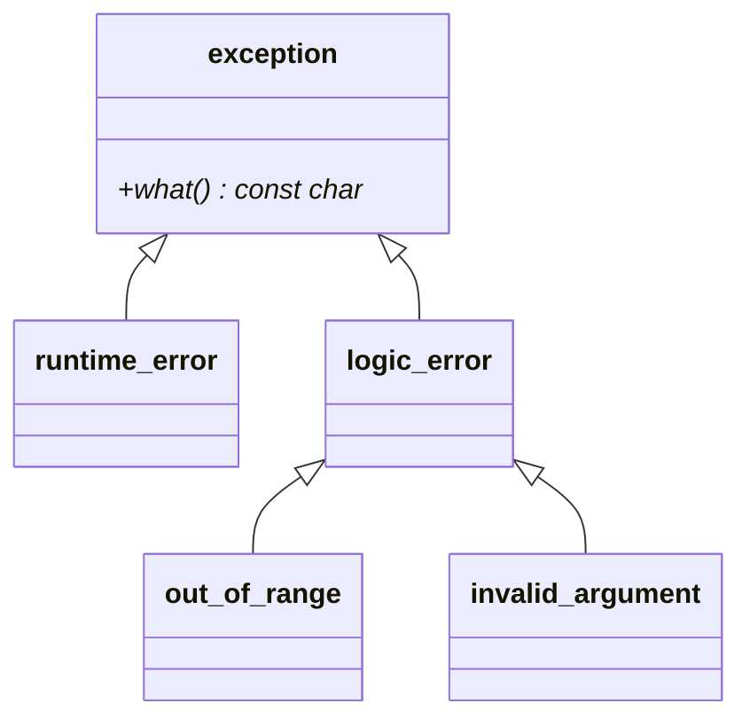

# 27.5 — Ngoại Lệ, Lớp & Tính Kế Thừa (Exceptions and Inheritance)

---

## 🎯 Mục Tiêu Bài Học
- Sử dụng thư viện chuẩn `<stdexcept>` và lớp nền tảng **`std::exception`**.
- **CẠM BẪY CHÍ MẠNG**: Bắt ngoại lệ bằng giá trị gây Object Slicing. Bắt buộc luôn dùng tham chiếu hằng: `catch (const std::exception& e)`.
- Quy tắc thứ tự khối `catch` khi có kế thừa: **Lớp con bắt trước, Lớp cha bắt sau**.

---

## 1. Hệ Thống Phân Cấp Ngoại Lệ Trong Thư Viện Chuẩn STL

Trong thực tế, chúng ta không ném các kiểu nguyên thủy (`int`, `char*`) mà luôn sử dụng các lớp ngoại lệ kế thừa từ **`std::exception`** (trong header `<stdexcept>`):



Hàm ảo `virtual const char* what() const noexcept;` trả về chuỗi thông báo lỗi chi tiết.

---

## 2. Cạm Bẫy Slicing: Luôn Bắt Ngoại Lệ Bằng Tham Chiếu Hằng

::: danger Cạm Bẫy Phổ Biến (Object Slicing Khi Catch)
Nếu bạn bắt ngoại lệ theo giá trị:
```cpp
catch (std::exception e) // NGUY HIỂM: Truyền tham trị!
{
    std::cout << e.what(); // BỊ CẮT GỌT! Mất thông tin của lớp con!
}
```
Toàn bộ phần thông tin chuyên biệt của ngoại lệ con (ví dụ `out_of_range`) sẽ bị cắt phăng đi do hiện tượng **Object Slicing**!

**QUY TẮC BẤT BIẾN**: Luôn luôn bắt ngoại lệ bằng **Tham Chiếu Hằng (`const Base&`)**:
```cpp
catch (const std::exception& e) // CHUẨN XÁC: Bảo toàn đa hình qua hàm what()!
{
    std::cout << e.what();
}
```
:::

---

## 3. Thứ Tự Bắt Ngoại Lệ Kế Thừa

Quy tắc so khớp của C++ là: Khối `catch` nào nằm trước sẽ được kiểm tra trước. Nếu một con trỏ hoặc tham chiếu lớp cha nằm ở trên, nó sẽ bắt luôn cả lớp con!

```cpp
#include <iostream>
#include <stdexcept>

int main()
{
    try
    {
        throw std::out_of_range{ "Chi so mang vuot qua gioi han!" };
    }
    // 1. KHỐI CON PHẢI ĐẶT TRƯỚC:
    catch (const std::out_of_range& e)
    {
        std::cerr << "Bat cu the out_of_range: " << e.what() << '\n';
    }
    // 2. KHỐI CHA ĐẶT SAU:
    catch (const std::exception& e)
    {
        std::cerr << "Bat tong quat std::exception: " << e.what() << '\n';
    }

    return 0;
}
```
