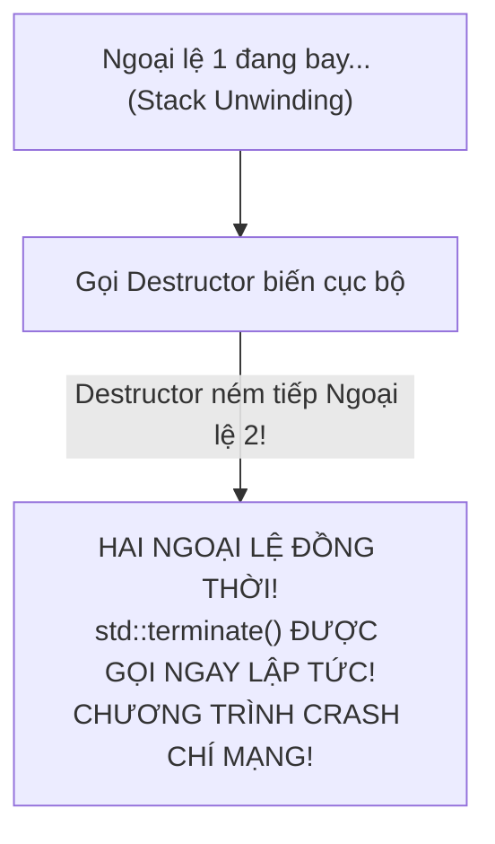

# 27.8 — Cạm Bẫy Sống Còn: Ngoại Lệ Trong Destructor & Mặt Trái Của Ngoại Lệ

---

## 🎯 Mục Tiêu Bài Học
- **CẠM BẪY CHÍ MẠNG BẬC NHẤT C++: NÉM NGOẠI LỆ TỪ DESTRUCTOR DẪN ĐẾN SẬP CHƯƠNG TRÌNH NGAY LẬP TỨC!**
- Hiểu quy định mặc định từ C++11: Mọi Destructor đều có thuộc tính **`noexcept(true)`**.
- Đánh giá mặt trái của ngoại lệ: Phình to kích thước file nhị phân (Unwind Tables) và chi phí khi xảy ra lỗi.

---

## 1. Cạm Bẫy Chí Mạng: Ngoại Lệ Trong Destructor

Hãy hình dung kịch bản kinh hoàng sau:
1. Hàm `foo()` phát hiện lỗi và ném ra Ngoại lệ số 1.
2. Trình biên dịch bắt đầu quá trình **Stack Unwinding** để dọn dẹp các biến cục bộ trong `foo()`.
3. Trong khi đang dọn dẹp, Destructor của một đối tượng cục bộ được gọi.
4. **Bên trong Destructor đó lại ném ra Ngoại lệ số 2!**

::: danger Quy Tắc Bất Biến Của Chuẩn ISO C++
C++ không cho phép tồn tại đồng thời 2 ngoại lệ đang được xử lý trong cùng một luồng. Nếu một Destructor ném ra ngoại lệ trong khi Stack Unwind đang diễn ra, C++ sẽ kích hoạt ngay hàm **`std::terminate()`** để bắn sập chương trình ngay lập tức!
:::

Vì lý do này, từ C++11 trở đi, **tất cả Destructor mặc định được ngầm định coi là `noexcept`**. Nếu một Destructor muốn ném ngoại lệ, nó bắt buộc phải tự bắt và giải quyết triệt để bên trong chính nó, không bao giờ được để ngoại lệ thoát ra ngoài!

---

## 2. Chi Phí Hiệu Năng Của Ngoại Lệ (Zero-Cost Exceptions)

Các trình biên dịch hiện đại (GCC/Clang/MSVC) sử dụng mô hình **Table-driven Zero-Cost Exceptions**:
- **Khi chương trình chạy bình thường (Happy path)**: Tốc độ thực thi nhanh ngang bằng mã không dùng ngoại lệ (Zero runtime overhead), không tốn chu kỳ CPU để kiểm tra cờ lỗi.
- **Mặt trái**: 
  - Kích thước tệp thực thi (`.exe` / ELF binary) tăng từ 15% - 30% do phải chứa các bảng tra cứu cấu trúc cuộn ngược ngăn xếp (**Exception Handling Tables / `.eh_frame`**).
  - Khi có lỗi thực sự xảy ra (Unhappy path), việc tra cứu bảng và cuộn ngược ngăn xếp diễn ra rất chậm, tốn hàng ngàn chu kỳ CPU. Do đó, **ngoại lệ chỉ dành cho các tình huống thực sự bất thường (exceptional), không dùng để điều khiển luồng logic thông thường!**
