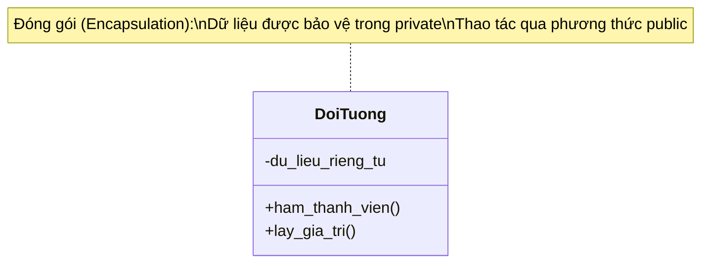

# 28.4 — Stream classes for strings

---

## 🎯 Mục Tiêu Bài Học
- Nắm vững bản chất lý thuyết và cơ chế hoạt động của **Stream classes for strings** trong tiêu chuẩn ISO C++.
- Hiểu rõ cách máy tính tổ chức bộ nhớ (RAM, CPU registers) khi thực thi mã nguồn liên quan.
- Nhận biết các cạm bẫy lỗi kinh điển (**Undefined Behavior**, Memory Leak, Bug logic) và cách phòng tránh.
- Áp dụng các quy tắc thực hành tốt nhất (**Best Practices**) chuẩn công nghiệp và cập nhật C++20/C++23 hiện đại.

---

# 28.4 &#8212; Stream classes for strings

So far, all of the I/O examples you have seen have been writing to cout or reading from cin.  However, there is another set of classes called the stream classes for strings that allow you to use the familiar insertions (&lt;&lt;) and extraction (&gt;&gt;) các toán tử to work with strings.  Like istream and ostream, the string streams provide a buffer to hold data.  However, unlike cin and cout, these streams are not connected to an I/O channel (such as a keyboard, monitor, etc…).  One of the primary uses of string streams is to buffer output for display at a later time, or to process input line-by-line.

There are six stream classes for strings: istringstream (derived from istream), ostringstream (derived from ostream), and stringstream (derived from iostream) are used for reading and writing normal characters width strings.  wistringstream, wostringstream, and wstringstream are used for reading and writing wide character strings.  To use the stringstreams, you need to #include the sstream header.

There are two ways to get data into a stringstream:


- Use the insertion (&lt;&lt;) toán tử:

```cpp
std::stringstream os {};
os << "en garde!\n"; // insert "en garde!" into the stringstream
```


- Use the str(string) hàm to set the value of the buffer:

```cpp
std::stringstream os {};
os.str("en garde!"); // set the stringstream buffer to "en garde!"
```

There are similarly two ways to get data out of a stringstream:


- Use the str() hàm to retrieve the results of the buffer:

```cpp
std::stringstream os {};
os << "12345 67.89\n";
std::cout << os.str();
```

This prints:

```cpp
12345 67.89
```


- Use the extraction (&gt;&gt;) toán tử:

```cpp
std::stringstream os {};
os << "12345 67.89"; // insert a string of numbers into the stream

std::string strValue {};
os >> strValue;

std::string strValue2 {};
os >> strValue2;

// print the numbers separated by a dash
std::cout << strValue << " - " << strValue2 << '\n';
```

This program prints:

```cpp
12345 - 67.89
```

Note that the &gt;&gt; toán tử iterates through the string -- each successive use of &gt;&gt; returns the next extractable value in the stream.  On the other hand, str() returns the whole value of the stream, even if the &gt;&gt; has already been used on the stream.

**Conversion between strings and numbers**

Because the insertion and extraction các toán tử know how to work with all of the basic các kiểu dữ liệu, we can use them in order to convert strings to numbers or vice versa.

First, let’s take a look at converting numbers into a string:

```cpp
std::stringstream os {};

constexpr int nValue { 12345 };
constexpr double dValue { 67.89 };
os << nValue << ' ' << dValue;

std::string strValue1, strValue2;
os >> strValue1 >> strValue2;

std::cout << strValue1 << ' ' << strValue2 << '\n';
```

This snippet prints:

```cpp
12345 67.89
```

Now let’s convert a numerical string to a number:

```cpp
std::stringstream os {};
os << "12345 67.89"; // insert a string of numbers into the stream
int nValue {};
double dValue {};

os >> nValue >> dValue;

std::cout << nValue << ' ' << dValue << '\n';
```

This program prints:

```cpp
12345 67.89
```

**Clearing a stringstream for reuse**

There are several ways to empty a stringstream’s buffer.


- Set it to the empty string using str() with a blank C-style string:

```cpp
std::stringstream os {};
os << "Hello ";

os.str(""); // erase the buffer

os << "World!";
std::cout << os.str();
```


- Set it to the empty string using str() with a blank std::string object:

```cpp
std::stringstream os {};
os << "Hello ";

os.str(std::string{}); // erase the buffer

os << "World!";
std::cout << os.str();
```

Both of these programs produce the following result:

```cpp
World!
```

When clearing out a stringstream, it is also generally a good idea to call the clear() hàm:

```cpp
std::stringstream os {};
os << "Hello ";

os.str(""); // erase the buffer
os.clear(); // reset error flags

os << "World!";
std::cout << os.str();
```

clear() resets any error flags that may have been set and returns the stream back to the ok state.  We will talk more about the stream state and error flags in the next lesson.

  	
  	

---



::: warning Cạm Bẫy: Khởi Tạo Không Đồng Nhất (Initialization Pitfalls)
Hãy luôn khởi tạo biến thành viên ngay tại nơi khai báo hoặc sử dụng **Danh sách khởi tạo thành viên (Member Initializer List)** trong hàm tạo để tránh việc đối tượng bị gán giá trị 2 lần gây lãng phí chu kỳ CPU.
:::

::: tip 💡 Tóm Tắt Quy Tắc Vàng (Core Guidelines)
1. Luôn hiểu rõ vòng đời và quyền sở hữu (Ownership) của dữ liệu trước khi viết code.
2. Ưu tiên khởi tạo đồng nhất với dấu ngoặc nhọn `{}` để ngăn chặn lỗi thu hẹp kiểu dữ liệu (Narrowing conversions).
3. Bật toàn bộ cờ cảnh báo `-Wall -Wextra -Wpedantic` để compiler giúp bạn phát hiện bug từ sớm!
:::
