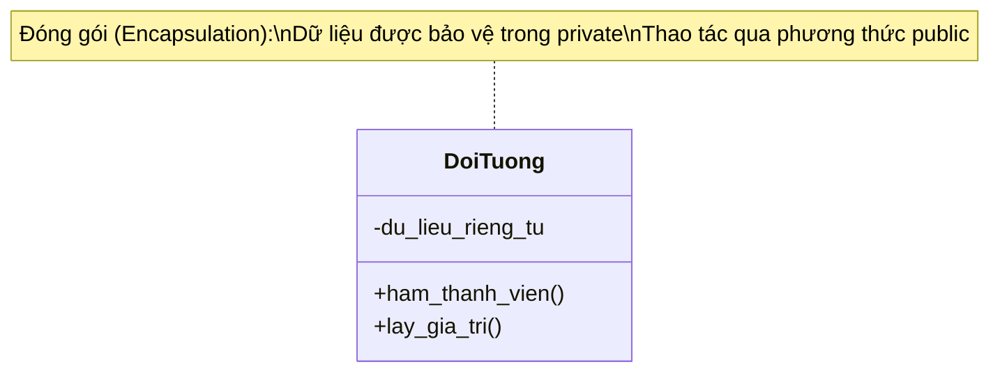

# 22.2 — std::string construction and destruction

---

## 🎯 Mục Tiêu Bài Học
- Nắm vững bản chất lý thuyết và cơ chế hoạt động của **std::string construction and destruction** trong tiêu chuẩn ISO C++.
- Hiểu rõ cách máy tính tổ chức bộ nhớ (RAM, CPU registers) khi thực thi mã nguồn liên quan.
- Nhận biết các cạm bẫy lỗi kinh điển (**Undefined Behavior**, Memory Leak, Bug logic) và cách phòng tránh.
- Áp dụng các quy tắc thực hành tốt nhất (**Best Practices**) chuẩn công nghiệp và cập nhật C++20/C++23 hiện đại.

---

# 22.2 &#8212; std::string construction and destruction

In this lesson, we’ll take a look at how to construct đối tượng of std::string, as well as how to create strings from numbers and vice-versa.

**String construction**

The string classes have a number of các hàm tạo (constructors) that can be used to create strings.  We’ll take a look at each of them here.

Note: string::size_type resolves to size_t, which is the same unsigned integral type that is returned by the sizeof toán tử.  The actual size of size_t depending on the environment.  For the purposes of this tutorial, envision it as an unsigned int.

</p>

**string::string()**</p>

<li>This is the default hàm tạo (constructor).  It creates an empty string.

Sample code:

```cpp
std::string sSource;
std::cout << sSource;
```

Output:

```cpp

```

**string::string(const string& strString)**</p>

<li>This is the copy hàm tạo (constructor).  This hàm tạo (constructor) creates a new string as a copy of strString.

Sample code:

```cpp
std::string sSource{ "my string" };
std::string sOutput{ sSource };
std::cout << sOutput;
```

Output:

```cpp
my string
```

**string::string(const string& strString, size_type unIndex)**

**string::string(const string& strString, size_type unIndex, size_type unLength)**</p>

<li>This hàm tạo (constructor) creates a new string that contains at most unLength characters from strString, starting with index unIndex.  If a NULL is encountered, the string copy will end, even if unLength has not been reached.
<li> If no unLength is supplied, all characters starting from unIndex will be used.
<li>If unIndex is larger than the size of the string, the out_of_range exception will be thrown.

Sample code:

```cpp
std::string sSource{ "my string" };
std::string sOutput{ sSource, 3 };
std::cout << sOutput<< '\n';
std::string sOutput2(sSource, 3, 4);
std::cout << sOutput2 << '\n';
```

Output:

```cpp
string
stri
```

**string::string(const char* szCString)**</p>

<li>This hàm tạo (constructor) creates a new string from the C-style string szCString, up to but not including the NULL terminator.
<li>If the resulting size exceeds the maximum string length, the length_error exception will be thrown.
<li>**Cảnh báo nguy hiểm:** szCString must not be NULL.

Sample code:

```cpp
const char* szSource{ "my string" };
std::string sOutput{ szSource };
std::cout << sOutput << '\n';
```

Output:

```cpp
my string
```

**string::string(const char* szCString, size_type unLength)**</p>

<li>This hàm tạo (constructor) creates a new string from the first unLength chars from the C-style string szCString.
<li>If the resulting size exceeds the maximum string length, the length_error exception will be thrown.
<li>**Cảnh báo nguy hiểm:** For this hàm only, NULLs are not treated as end-of-string characters in szCString!  This means it is possible to read off the end of your string if unLength is too big.  Be careful not to overflow your string buffer!

Sample code:

```cpp
const char* szSource{ "my string" };
std::string sOutput(szSource, 4);
std::cout << sOutput << '\n';
```

Output:

```cpp
my s
```

**string::string(size_type nNum, char chChar)**</p>

<li>This hàm tạo (constructor) creates a new string được khởi tạo by nNum occurances of the character chChar.
<li>If the resulting size exceeds the maximum string length, the length_error exception will be thrown.

Sample code:

```cpp
std::string sOutput(4, 'Q');
std::cout << sOutput << '\n';
```

Output:

```cpp
QQQQ
```

**template<class InputIterator> string::string(InputIterator itBeg, InputIterator itEnd)**</p>

<li>This hàm tạo (constructor) creates a new string được khởi tạo by the characters of range [itBeg, itEnd).
<li>If the resulting size exceeds the maximum string length, the length_error exception will be thrown.

No sample code for this one.  It’s obscure enough you’ll probably never use it.

<p>

**string::~string()**</p>

**String destruction**

<li>This is the hàm hủy (destructor).  It destroys the string and frees the memory.

No sample code here either since the hàm hủy (destructor) isn’t called explicitly.

<p>
<p>**Constructing strings from numbers**

One notable omission in the std::string class is the lack of ability to create strings from numbers.  For example:

```cpp
std::string sFour{ 4 };
```

Produces the following error:

```cpp
c:vcprojectstest2test2test.cpp(10) : error C2664: 'std::basic_string<_Elem,_Traits,_Ax>::basic_string(std::basic_string<_Elem,_Traits,_Ax>::_Has_debug_it)' : cannot convert parameter 1 from 'int' to 'std::basic_string<_Elem,_Traits,_Ax>::_Has_debug_it'
```

Remember what I said about the string classes producing horrible looking errors?  The relevant bit of information here is:

```cpp
cannot convert parameter 1 from 'int' to 'std::basic_string
```

In other words, it tried to convert your int into a string but failed.

The easiest way to convert numbers into strings is to involve the std::ostringstream class.  std::ostringstream is already set up to accept input from a variety of sources, including characters, numbers, strings, etc…  It is also capable of outputting strings (either via the extraction toán tử>>, or via the str() hàm).  For more information on std::ostringstream, see [28.4 -- Stream classes for strings](https://www.learncpp.com/cpp-tutorial/stream-classes-for-strings/).  

Here’s a simple solution for creating std::string from various types of inputs:

```cpp
#include <iostream>
#include <sstream>
#include <string>
 
template <typename T>
inline std::string ToString(T tX)
{
    std::ostringstream oStream;
    oStream << tX;
    return oStream.str();
}
```

Here’s some sample code to test it:

```cpp
int main()
{
    std::string sFour{ ToString(4) };
    std::string sSixPointSeven{ ToString(6.7) };
    std::string sA{ ToString('A') };
    std::cout << sFour << '\n';
    std::cout << sSixPointSeven << '\n';
    std::cout << sA << '\n';
}
```

And the output:

```cpp
4
6.7
A
```

Note that this solution omits any error checking.  It is possible that inserting tX into oStream could fail.  An appropriate response would be to throw an exception if the conversion fails.

::: info Related content

The standard library also contains a hàm named `std::to_string()` that can be used to convert numbers into a std::string.  While this is a simpler solution for basic cases, the output of std::to_string may differ from the output of std::cout or our ToString() hàm above.  Some of these differences are currently documented [here](https://en.cppreference.com/w/cpp/string/basic_string/to_string).
:::

<p>**Converting strings to numbers**

Similar to the solution above:

```cpp
#include <iostream>
#include <sstream>
#include <string>
 
template <typename T>
inline bool FromString(const std::string& sString, T& tX)
{
    std::istringstream iStream(sString);
    return !(iStream >> tX).fail(); // extract value into tX, return success or not
}
```

Here’s some sample code to test it:

```cpp
int main()
{
    double dX;
    if (FromString("3.4", dX))
        std::cout << dX << '\n'; 
    if (FromString("ABC", dX))
        std::cout << dX << '\n'; 
}
```

And the output:

```cpp
3.4
```

Note that the second conversion failed and returned false.

</a>
  	<a class="nav-link" href="/">
  
    <i class="fa fa-home" aria-hidden="true"></i>
    
      Back to table of contents
    
</a>
  	<a class="nav-link" href="https://www.learncpp.com/cpp-tutorial/stdstring-and-stdwstring/">
  
    <i class="fa fa-chevron-circle-left" aria-hidden="true"></i>
    
      Previous lesson
      
        22.1std::string and std::wstring
      
    
  </a>


---





::: warning Cạm Bẫy: Khởi Tạo Không Đồng Nhất (Initialization Pitfalls)
Hãy luôn khởi tạo biến thành viên ngay tại nơi khai báo hoặc sử dụng **Danh sách khởi tạo thành viên (Member Initializer List)** trong hàm tạo để tránh việc đối tượng bị gán giá trị 2 lần gây lãng phí chu kỳ CPU.
:::


::: tip 💡 Tóm Tắt Quy Tắc Vàng (Core Guidelines)
1. Luôn hiểu rõ vòng đời và quyền sở hữu (Ownership) của dữ liệu trước khi viết code.
2. Ưu tiên khởi tạo đồng nhất với dấu ngoặc nhọn `{}` để ngăn chặn lỗi thu hẹp kiểu dữ liệu (Narrowing conversions).
3. Bật toàn bộ cờ cảnh báo `-Wall -Wextra -Wpedantic` để compiler giúp bạn phát hiện bug từ sớm!
:::
