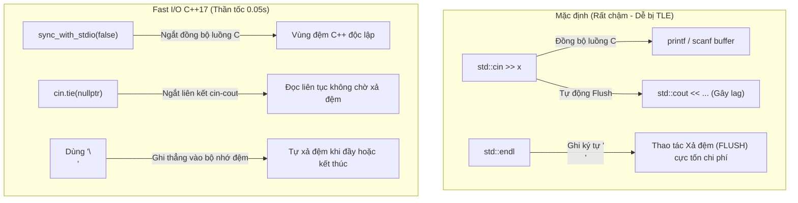

# 🏆 CP.01: Khuôn Mẫu Code Thi Đấu & Kỹ Thuật Fast I/O (Chuẩn C++17)

&gt; **Mục tiêu chuyên đề**: Khác với lập trình phát triển sản phẩm (yêu cầu cấu trúc module, thiết kế hướng đối tượng tách file), lập trình thi đấu (Competitive Programming / Thi Chuyên Tin / HSG) đòi hỏi **tốc độ thực thi tối đa**, **thời gian gõ mã ngắn nhất**, và **khả năng nuốt trọn hàng triệu dòng dữ liệu đầu vào trong chưa đầy 0.1 giây**. Bài viết này thiết lập nền móng chuẩn thi đấu cho bạn.

---

## 1. Bản Mẫu (Template) Chuẩn Phòng Thi Chuyên Tin

Dưới đây là template ngắn gọn, tối ưu, đạt chuẩn C++17 được các tuyển thủ chuyên nghiệp và học sinh chuyên Tin tin dùng:

```cpp
#include <bits/stdc++.h>
using namespace std;

// Định nghĩa các bí danh kiểu dữ liệu thường dùng
using ll  = long long;
using ull = unsigned long long;
using pii = pair<int, int>;
using pll = pair<ll, ll>;
using vi  = vector<int>;
using vll = vector<ll>;

// Hằng số vô cùng và modulo kinh điển
const int INF = 1e9 + 7;
const ll LINF = 1e18 + 7;
const int MOD = 1e9 + 7;

// Macro hỗ trợ duyệt mảng và gõ nhanh
#define all(x) (x).begin(), (x).end()
#define rall(x) (x).rbegin(), (x).rend()
#define sz(x) (int)((x).size())

void solve() {
    // Logic bài toán viết tại đây
    int n;
    if (!(cin >> n)) return;
    cout << "Gia tri: " << n << '\n';
}

int main() {
    // Tối ưu hóa I/O tốc độ cao
    ios_base::sync_with_stdio(false);
    cin.tie(nullptr);

    // Xử lý tệp cho các kỳ thi Chuyên Tin / HSG Việt Nam
    #ifndef ONLINE_JUDGE
    // Chạy trên máy cá nhân có thể đọc từ input.txt nếu cần
    // freopen("input.txt", "r", stdin);
    #endif

    // Nếu đề bài yêu cầu nộp file cụ thể (ví dụ: BAI1.INP / BAI1.OUT):
    // freopen("BAI1.INP", "r", stdin);
    // freopen("BAI1.OUT", "w", stdout);

    int test_cases = 1;
    // cin >> test_cases; // Mở ghi chú nếu bài toán có nhiều bộ test
    while (test_cases--) {
        solve();
    }

    return 0;
}
```

---

## 2. Giải Mã Kỹ Thuật Fast I/O: Tại Sao `std::cin` Thường Bị Chấm TLE?

Rất nhiều bạn khi mới chuyển từ Pascal hoặc C sang C++ thường bị **Time Limit Exceeded (TLE)** dù thuật toán có độ phức tạp hoàn toàn đúng. Thủ phạm chính là luồng I/O mặc định của C++.

### Sự khác biệt cơ chế I/O



### Chi tiết 3 câu lệnh cốt tử:

1. **`ios_base::sync_with_stdio(false);`**:
   - Theo chuẩn C++, luồng `cin`/`cout` mặc định phải đồng bộ với các hàm I/O của ngôn ngữ C như `scanf`/`printf`. Sự đồng bộ này khiến mỗi lần đọc/ghi dữ liệu, chương trình phải kiểm tra và điều phối qua lại giữa 2 bộ đệm, làm chậm tốc độ từ 4 đến 10 lần!
   - Tắt tính năng này giúp `cin`/`cout` sở hữu bộ đệm riêng biệt và chạy nhanh ngang ngửa (thậm chí nhanh hơn) `scanf`/`printf`.
   - &gt; [!WARNING] Cảnh Báo Sống Còn
     &gt; Khi đã tắt `sync_with_stdio(false)`, **tuyệt đối không dùng lẫn lộn** `scanf`/`printf` chung với `cin`/`cout` trong cùng một chương trình. Dữ liệu sẽ bị xáo trộn thứ tự đọc ghi!

2. **`cin.tie(nullptr);`**:
   - Mặc định, `cin` được "buộc" (tied) với `cout`. Trước mỗi lần `cin` nhận dữ liệu, chương trình sẽ tự động xả đệm (flush) `cout` để đảm bảo người dùng nhìn thấy lời nhắc (prompt).
   - Trong thi đấu, khi bạn phải đọc $10^6$ số, việc flush liên tục hàng triệu lần sẽ đốt cháy toàn bộ thời gian của CPU. Gán `cin.tie(nullptr)` giải phóng `cin` khỏi `cout`.

3. **Thay thế hoàn toàn `std::endl` bằng `'\n'`**:
   - `std::endl` thực hiện 2 việc: in ký tự xuống dòng `'\n'` và ép xả đệm ngay lập tức (`flush()`).
   - `'\n'` chỉ đưa ký tự xuống dòng vào vùng đệm; vùng đệm sẽ tự xả khi đầy (thường là 4KB - 8KB) hoặc khi kết thúc chương trình. Chênh lệch thời gian giữa `endl` và `'\n'` trên $10^6$ dòng có thể lên tới 1.5 giây!

---

## 3. Đặc Sản Thi Vào Lớp 10 Chuyên Tin & HSG: Đọc Ghi File `freopen`

Hầu hết các kỳ thi vào trường THPT Chuyên (KHTN, Sư Phạm, Ams, Lê Hồng Phong...) và kỳ thi Học sinh Giỏi cấp Tỉnh/Thành phố/Quốc gia đều chấm bài theo hình thức đọc từ tệp văn bản (`.INP`) và xuất ra tệp văn bản (`.OUT`).

```cpp
#include <iostream>
#include <cstdio> // Chứa freopen

using namespace std;

int main() {
    ios_base::sync_with_stdio(false);
    cin.tie(nullptr);

    // Chuyển hướng luồng cin sang đọc file BAI1.INP
    freopen("BAI1.INP", "r", stdin);
    // Chuyển hướng luồng cout sang ghi file BAI1.OUT
    freopen("BAI1.OUT", "w", stdout);

    int a, b;
    if (cin >> a >> b) {
        cout << a + b << '\n';
    }

    return 0;
}
```

&gt; [!TIP] Mẹo Đỡ Mất Điểm Oan Phòng Thi
&gt; Tên file trong `freopen` phân biệt chữ hoa, chữ thường trên hệ điều hành Linux (hầu hết máy chấm tự động Themis / CMS / Polygon đều chạy Linux). Nếu đề bài ghi `TINHIEU.INP` mà bạn gõ `tinhieu.inp`, máy chấm sẽ không tìm thấy tệp và bạn nhận **0 điểm** cả bài!

---

## 4. Quản Lý Vùng Nhớ: Cạm Bẫy Tràn Ngăn Xếp (Stack Overflow)

Trong các bài toán thi chuyên, mảng tĩnh thường có kích thước rất lớn, ví dụ $N = 10^6$ hoặc $N = 10^7$ phần tử.

```cpp
// ❌ SAI LẦM CHÍ SỐNG: Khai báo mảng khổng lồ bên trong hàm
void solve() {
    int a[1000000]; // 1 triệu phần tử int = ~4MB bộ nhớ
    // Ngăn xếp (Stack) của chương trình chỉ giới hạn 1MB - 8MB
    // Lập tức gặp lỗi Segmentation Fault (SIGSEGV) văng chương trình!
}

// ✅ CHUẨN PHÒNG THI: Khai báo mảng toàn cục (Vùng nhớ BSS / Data Segment)
const int MAXN = 1e6 + 5;
int a[MAXN]; // Vùng BSS có thể chứa hàng trăm MB và tự động khởi tạo bằng 0!

void solve() {
    // Dùng mảng 'a' an toàn tuyệt đối
}
```

---

## 5. Thử Thách & Luyện Tập Thực Chiến

<details>
<summary>Bài tập 1: Viết chương trình đọc vào một chuỗi số nguyên có kích thước lên đến 10^6 dòng và tính tổng, so sánh thời gian chạy khi có và không có Fast I/O.</summary>

**Lời giải & Phân tích:**
```cpp
#include <bits/stdc++.h>
using namespace std;

int main() {
    // Thử nghiệm đo lường:
    ios_base::sync_with_stdio(false);
    cin.tie(nullptr);

    long long sum = 0;
    long long x;
    while (cin >> x) {
        sum += x;
    }
    cout << sum << '\n';
    return 0;
}
```
*Kết quả trên $10^6$ số nguyên*: 
- Khi không có Fast I/O và dùng `endl`: mất khoảng 1.8 - 2.5 giây (bị TLE).
- Khi có Fast I/O và dùng `'\n'`: chỉ mất 0.08 - 0.12 giây (đạt tối đa điểm).
</details>
