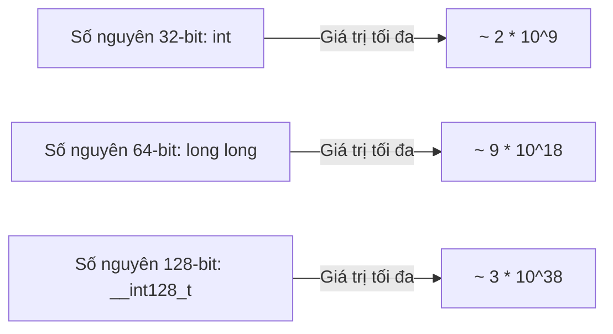

# 🏆 CP.02: Ước Lượng Thời Gian, Bộ Nhớ & Kỹ Thuật "Ăn Subtask"

&gt; **Quy tắc vàng của tuyển thủ Chuyên Tin**: Trong một kỳ thi lập trình, người giải được trọn vẹn thuật toán tối ưu là cao thủ, nhưng người biết chia nhỏ bài toán để **vét sạch điểm của từng Subtask** mới là người chắc suất đỗ vào trường chuyên!

---

## 1. Giới Hạn Thời Gian & Quy Tắc 10^8 Phép Tính / Giây

Hầu hết các hệ thống máy chấm (Themis, CMS, VNOI, Codeforces, LeetCode) cấp cho mỗi bài toán khoảng **1.0 giây** (đôi khi là 2.0s) và giới hạn bộ nhớ **256MB** (hoặc 512MB).

Một CPU hiện đại chạy trong môi trường máy chấm thực hiện được khoảng **$10^8$ phép toán cơ bản** (cộng, trừ, so sánh, truy cập bộ nhớ) trong vòng **1 giây**.

### Bảng Tra Cứu Thần Tốc: Nhìn Giới Hạn $N$ Đoán Ngay Thuật Toán

| Kích Thước Dữ Liệu $N$ | Độ Phức Tạp Khả Thi Tối Đa | Thuật Toán Tiêu Biểu Thường Gặp |
| :--- | :--- | :--- |
| $N \le 10$ | $O(N!)$ hoặc $O(N^6)$ | Sinh hoán vị (`next_permutation`), quay lui vét cạn toàn bộ |
| $N \le 20 - 25$ | $O(2^N)$ hoặc $O(N \cdot 2^N)$ | Quay lui sinh tập con, Quy hoạch động Bitmask, Meet-in-the-middle |
| $N \le 50 - 100$ | $O(N^4)$ hoặc $O(N^3)$ | Quy hoạch động đoạn, Thuật toán Floyd-Warshall, nhân ma trận |
| $N \le 500 - 2000$ | $O(N^2)$ | Duyệt 2 vòng lặp lồng nhau, Dijkstra ma trận kề, Quy hoạch động 2D cơ bản |
| $N \le 10^5 - 5 \cdot 10^5$ | $O(N \log N)$ hoặc $O(N \log^2 N)$ | Sắp xếp (`std::sort`), Cây Phân Đoạn (Segment Tree), Fenwick (BIT), DSU, Chặt nhị phân |
| $N \le 10^6 - 10^7$ | $O(N)$ hoặc $O(N \log \log N)$ | Duyệt 1 vòng lặp, Hai con trỏ (Two Pointers), Sàng số nguyên tố Eratosthenes, Mảng cộng dồn |
| $N \le 10^{18}$ | $O(\log N)$ hoặc $O(1)$ | Lũy thừa nhị phân, Thuật toán Euclid tìm ước chung lớn nhất (GCD), Nhân ma trận tính Fibonacci |

---

## 2. Cạm Bẫy Tràn Số (Integer Overflow) & Cách Khắc Phục C++17

Tràn số là nguyên nhân số một khiến bài thi chạy đúng trên máy nhà nhưng bị 0 điểm hoặc Wrong Answer (WA) khi nộp lên máy chấm.



### 3 Bẫy Tràn Số Điển Hình:

1. **Phép nhân hai số `int` vượt quá $2 \cdot 10^9$**:
   ```cpp
   int a = 1000000;
   int b = 1000000;
   long long c = a * b; // ❌ SAI LẦM: Phép nhân 'a * b' vẫn tính theo kiểu int trước rồi mới ép kiểu sang c!
   // Kết quả 'c' sẽ là một số âm kỳ quặc!

   // ✅ SỬA ĐÚNG:
   long long c = 1LL * a * b; // Nhân trước với 1LL (long long) để ép kiểu ngay lập tức
   // hoặc:
   long long c = static_cast<long long>(a) * b;
   ```

2. **Cộng dồn mảng số nguyên**:
   ```cpp
   // Nếu mảng có N = 10^5 phần tử, mỗi phần tử lên đến 10^9
   // Tổng mảng có thể lên đến 10^14 -> Phải dùng long long cho biến tổng và mảng cộng dồn!
   long long sum = 0;
   ```

3. **Phép nhân có chia dư (Modulo Arithmetic)**:
   ```cpp
   const int MOD = 1e9 + 7;
   int a = 800000000;
   int b = 900000000;
   // int ans = (a * b) % MOD; // ❌ Tràn số int trước khi kịp chia dư!
   int ans = (1LL * a * b) % MOD; // ✅ An toàn tuyệt đối
   ```

---

## 3. Chiến Thuật "Ăn Trọn Subtask" (Kỹ Năng Sống Còn Khi Thi Chuyên)

Đề thi Chuyên Tin hiện nay luôn được chia thành các **Subtask** rõ ràng. Ví dụ:
- **Subtask 1 (30% điểm)**: $N \le 20$.
- **Subtask 2 (30% điểm)**: $N \le 2000$.
- **Subtask 3 (40% điểm)**: $N \le 10^5$.

```cpp
#include <bits/stdc++.h>
using namespace std;

int n;
vector<int> a;

// Subtask 1: Vét cạn O(2^N)
void subtask1() {
    int ans = 0;
    // Quay lui hoặc duyệt bitmask
    cout << ans << '\n';
}

// Subtask 2: Quy hoạch động O(N^2)
void subtask2() {
    int ans = 0;
    // Dùng 2 vòng lặp lồng nhau
    cout << ans << '\n';
}

// Subtask 3: Thuật toán tối ưu O(N log N) dùng Segment Tree
void subtask3() {
    int ans = 0;
    // Thuật toán đầy đủ
    cout << ans << '\n';
}

int main() {
    ios_base::sync_with_stdio(false);
    cin.tie(nullptr);

    cin >> n;
    a.resize(n);
    for (int i = 0; i < n; ++i) cin >> a[i];

    // Điều hướng theo giá trị N của từng test case để không bỏ lỡ điểm!
    if (n <= 20) {
        subtask1();
    } else if (n <= 2000) {
        subtask2();
    } else {
        subtask3();
    }

    return 0;
}
```

&gt; [!TIP] Chiến Lược Phân Bổ Thời Gian Trong Phòng Thi
&gt; Đừng bao giờ ngồi nghĩ thuật toán tối ưu cho bài khó suốt 2 tiếng mà không viết một dòng code nào! Hãy viết ngay một hàm vét cạn (brute-force) để nộp lấy điểm Subtask 1 (ăn chắc 30-40% điểm số), sau đó mới nâng cấp dần lên thuật toán tối ưu.
