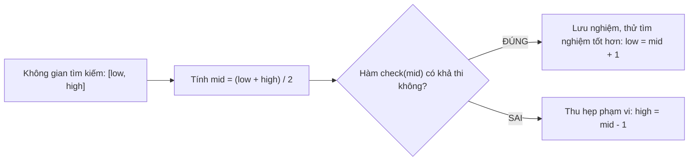

# 🏆 CP.05: Các Kỹ Thuật Lập Trình Kinh Điển Trong Đề Thi

&gt; **Bộ công cụ thực chiến**: Trong kỳ thi tuyển sinh Chuyên Tin và HSG, các bài toán thường không yêu cầu cấu trúc dữ liệu quá cao siêu, mà đòi hỏi khả năng biến đổi và áp dụng nhuần nhuyễn **5 kỹ thuật kinh điển** dưới đây.

---

## 1. Mảng Cộng Dồn (Prefix Sum) 1D & 2D

### Bài toán 1D:
Cho mảng $A$ gồm $N$ phần tử. Có $Q$ truy vấn, mỗi truy vấn hỏi tổng các phần tử từ chỉ số $L$ đến $R$ ($1 \le L \le R \le N$). Với $N, Q \le 10^5$, nếu duyệt vòng lặp từng truy vấn sẽ tốn $O(Q \times N) \approx 10^{10}$ phép tính (bị TLE ngay lập tức).

**Giải pháp Prefix Sum $O(1)$ mỗi truy vấn**:
- Định nghĩa: $pref[i] = A[1] + A[2] + \dots + A[i]$.
- Công thức: $pref[i] = pref[i - 1] + A[i]$.
- Tổng đoạn $[L, R]$ tính trong $O(1)$:
  $$\text{Sum}(L, R) = pref[R] - pref[L - 1]$$

```cpp
#include <vector>
#include <iostream>

using namespace std;
using ll = long long;

int main() {
    int n = 5;
    vector<ll> a = {0, 2, 4, 1, 7, 3}; // Đánh chỉ số từ 1
    vector<ll> pref(n + 1, 0);

    for (int i = 1; i <= n; ++i) {
        pref[i] = pref[i - 1] + a[i];
    }

    // Truy vấn tổng từ vị trí 2 đến 4 (a[2] + a[3] + a[4] = 4 + 1 + 7 = 12)
    int L = 2, R = 4;
    cout << "Tong doan [" << L << ", " << R << "] = " << pref[R] - pref[L - 1] << '\n';

    return 0;
}
```

### Mảng Cộng Dồn 2D (Hình Chữ Nhật):
Tính tổng các ô trong hình chữ nhật từ $(x_1, y_1)$ đến $(x_2, y_2)$ trên lưới $N \times M$:
$$\text{Sum} = pref[x_2][y_2] - pref[x_1-1][y_2] - pref[x_2][y_1-1] + pref[x_1-1][y_1-1]$$

---

## 2. Mảng Hiệu (Difference Array): Cập Nhật Đoạn $O(1)$

Bài toán: Có $Q$ thao tác, mỗi thao tác yêu cầu: *"Cộng thêm giá trị $V$ vào tất cả các phần tử trong đoạn từ $L$ đến $R$"*. Sau khi hoàn tất $Q$ thao tác, in ra mảng cuối cùng.

**Thuật toán Mảng hiệu**:
1. Khởi tạo mảng hiệu $diff$ với $diff[i] = A[i] - A[i - 1]$.
2. Mỗi thao tác cộng $V$ vào đoạn $[L, R]$:
   - `diff[L] += V;`
   - `diff[R + 1] -= V;`
3. Cuối cùng, khôi phục lại mảng bằng một lượt cộng dồn duy nhất $O(N)$!

```cpp
#include <vector>
#include <iostream>

using namespace std;

int main() {
    int n = 5;
    vector<long long> diff(n + 2, 0);

    // Thao tác 1: Cộng 3 vào đoạn [1, 3]
    diff[1] += 3; diff[4] -= 3;

    // Thao tác 2: Cộng 5 vào đoạn [2, 5]
    diff[2] += 5; diff[6] -= 5;

    // Khôi phục mảng kết quả:
    vector<long long> res(n + 1, 0);
    for (int i = 1; i <= n; ++i) {
        res[i] = res[i - 1] + diff[i];
        cout << res[i] << ' ';
    }
    cout << '\n'; // Kết quả: 3 8 8 5 5

    return 0;
}
```

---

## 3. Kỹ Thuật Hai Con Trỏ (Two Pointers) & Cửa Sổ Trượt (Sliding Window)

Tối ưu độ phức tạp từ $O(N^2)$ xuống $O(N)$ khi tìm dãy con liên tiếp thỏa mãn điều kiện (ví dụ: tìm dãy con ngắn nhất có tổng $\ge S$).

```cpp
#include <vector>
#include <iostream>
#include <algorithm>

using namespace std;

// Tìm độ dài đoạn con ngắn nhất có tổng >= target
int minSubArrayLen(int target, const vector<int>& nums) {
    int n = nums.size();
    int min_len = 1e9;
    long long cur_sum = 0;
    int left = 0;

    for (int right = 0; right < n; ++right) {
        cur_sum += nums[right];
        // Thu hẹp cửa sổ từ phía bên trái
        while (cur_sum >= target) {
            min_len = min(min_len, right - left + 1);
            cur_sum -= nums[left++];
        }
    }

    return (min_len == 1e9 ? 0 : min_len);
}
```

---

## 4. Chặt Nhị Phân Trên Tập Kết Quả (Binary Search on Answer)

Đây là dạng toán xuất hiện trong **90% đề thi Chuyên Tin**.
Dấu hiệu nhận biết: Đề bài yêu cầu:
- *"Tìm giá trị $X$ **lớn nhất** sao cho điều kiện $P(X)$ vẫn thỏa mãn"*
- Hoặc *"Tìm thời gian $T$ **nhỏ nhất** để hoàn thành công việc"*



### Bộ Khung Code Mẫu (Template):
```cpp
#include <iostream>
using namespace std;

// Hàm kiểm tra xem với giá trị 'val', bài toán có thỏa mãn không
bool check(long long val) {
    // Logic kiểm tra trong O(N)
    return true; 
}

long long binary_search_ans(long long low, long long high) {
    long long ans = -1;
    while (low <= high) {
        long long mid = low + (high - low) / 2;
        if (check(mid)) {
            ans = mid;         // Ghi nhận nghiệm hợp lệ
            low = mid + 1;     // Với bài toán tìm MAX: thử tìm giá trị lớn hơn
            // high = mid - 1; // Với bài toán tìm MIN: thử tìm giá trị nhỏ hơn
        } else {
            high = mid - 1;
        }
    }
    return ans;
}
```

---

## 5. Quay Lui & Nhánh Cận (Backtracking with Pruning)

Dạng bài "cứu cánh" ăn chắc điểm Subtask nhỏ ($N \le 20$). Để tránh TLE, kỹ thuật **Nhánh cận (Pruning)** dừng ngay nhánh đệ quy nếu chi phí hiện tại đã vượt qua kết quả tối ưu tạm thời.

```cpp
#include <iostream>
#include <vector>

using namespace std;

int n = 4;
vector<bool> cot(20, false), cheo_chinh(40, false), cheo_phu(40, false);
int so_cach = 0;

// Bài toán xếp N quân Hậu trên bàn cờ N x N
void dat_hau(int hang) {
    if (hang > n) {
        ++so_cach;
        return;
    }
    for (int col = 1; col <= n; ++col) {
        // Nhánh cận: Chỉ đặt nếu cột và các đường chéo chưa bị kiểm soát
        if (!cot[col] && !cheo_chinh[hang - col + n] && !cheo_phu[hang + col]) {
            cot[col] = cheo_chinh[hang - col + n] = cheo_phu[hang + col] = true;
            dat_hau(hang + 1);
            // Quay lui khôi phục trạng thái
            cot[col] = cheo_chinh[hang - col + n] = cheo_phu[hang + col] = false;
        }
    }
}
```
