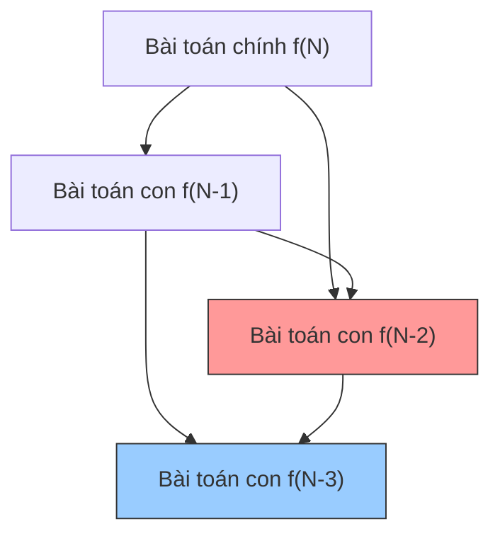

# 🏆 CP.06: Quy Hoạch Động (Dynamic Programming) - Chìa Khóa Vàng Điểm Cao

&gt; **Vũ khí phân loại thí sinh**: Trong mọi đề thi Học sinh Giỏi và tuyển sinh Chuyên Tin, bài toán mang tính chất phân loại thủ khoa / á khoa gần như luôn là một bài **Quy hoạch động (DP)**. Hiểu được bản chất tư duy DP sẽ giúp bạn không còn sợ hãi bất kỳ đề thi nào.

---

## 1. Bản Chất Của Quy Hoạch Động

Quy hoạch động là kỹ thuật giải quyết bài toán lớn bằng cách **chia nó thành các bài toán con gối nhau** (overlapping subproblems) và **lưu trữ kết quả của các bài toán con** (memoization/tabulation) để không bao giờ phải tính lại lần thứ hai.



---

## 2. Bài Toán 1: Dãy Con Tăng Dài Nhất (LIS) Từ $O(N^2)$ Lên $O(N \log N)$

Cho mảng $A$ gồm $N$ số. Tìm độ dài dãy con (không nhất thiết liên tiếp) tăng nghiêm ngặt dài nhất.

### Cách 1: DP Căn bản $O(N^2)$ (Đạt trọn điểm Subtask 1 & 2):
- Gọi $dp[i]$ là độ dài dãy con tăng dài nhất kết thúc tại chỉ số $i$.
- Công thức: $dp[i] = 1 + \max(dp[j])$ với mọi $j &lt; i$ và $A[j] &lt; A[i]$.

```cpp
#include <vector>
#include <algorithm>
#include <iostream>

using namespace std;

int lis_n2(const vector<int>& a) {
    int n = a.size();
    vector<int> dp(n, 1);
    int ans = 1;
    for (int i = 0; i < n; ++i) {
        for (int j = 0; j < i; ++j) {
            if (a[j] < a[i]) {
                dp[i] = max(dp[i], dp[j] + 1);
            }
        }
        ans = max(ans, dp[i]);
    }
    return ans;
}
```

### Cách 2: Tối ưu đỉnh cao $O(N \log N)$ Với `std::lower_bound` (Ăn trọn 100% điểm):
- Duy trì mảng `tails`, trong đó `tails[len]` lưu giá trị phần tử kết thúc nhỏ nhất của một dãy con tăng có độ dài `len`.

```cpp
int lis_nlogn(const vector<int>& a) {
    vector<int> tails;
    for (int x : a) {
        auto it = lower_bound(tails.begin(), tails.end(), x);
        if (it == tails.end()) {
            tails.push_back(x); // Mở rộng độ dài dãy con tăng
        } else {
            *it = x; // Tối ưu giá trị kết thúc nhỏ hơn cho độ dài tương ứng
        }
    }
    return tails.size();
}
```

---

## 3. Bài Toán 2: Bài Toán Cái Túi (0/1 Knapsack) & Tối Ưu Bộ Nhớ $O(W)$

Cho $N$ đồ vật, vật thứ $i$ có khối lượng $w[i]$ và giá trị $v[i]$. Một chiếc balo có sức chứa tối đa $W$. Hãy chọn các đồ vật sao cho tổng giá trị lớn nhất mà không làm rách balo.

```cpp
#include <vector>
#include <iostream>
#include <algorithm>

using namespace std;

int knapsack(int W, const vector<int>& w, const vector<int>& v) {
    int n = w.size();
    // Kỹ thuật nén mảng 1 chiều O(W) bộ nhớ thay vì O(N * W)
    vector<int> dp(W + 1, 0);

    for (int i = 0; i < n; ++i) {
        // Duyệt NGƯỢC từ W về w[i] để mỗi đồ vật chỉ được chọn 1 lần duy nhất!
        for (int j = W; j >= w[i]; --j) {
            dp[j] = max(dp[j], dp[j - w[i]] + v[i]);
        }
    }

    return dp[W];
}

int main() {
    int W = 10;
    vector<int> w = {2, 3, 5, 7};
    vector<int> v = {10, 20, 35, 60};
    cout << "Gia tri lon nhat co the mang: " << knapsack(W, w, v) << '\n'; // 70 (chọn vật 1 và 4)
    return 0;
}
```

---

## 4. Bài Toán 3: Xâu Con Chung Dài Nhất (LCS)

Cho hai xâu $S_1$ (độ dài $N$) và $S_2$ (độ dài $M$). Tìm độ dài của xâu con chung dài nhất của cả hai xâu.

```cpp
#include <vector>
#include <string>
#include <iostream>
#include <algorithm>

using namespace std;

int lcs(const string& s1, const string& s2) {
    int n = s1.size();
    int m = s2.size();
    // dp[i][j]: LCS của tiền tố độ dài i của s1 và tiền tố độ dài j của s2
    vector<vector<int>> dp(n + 1, vector<int>(m + 1, 0));

    for (int i = 1; i <= n; ++i) {
        for (int j = 1; j <= m; ++j) {
            if (s1[i - 1] == s2[j - 1]) {
                dp[i][j] = dp[i - 1][j - 1] + 1;
            } else {
                dp[i][j] = max(dp[i - 1][j], dp[i][j - 1]);
            }
        }
    }

    return dp[n][m];
}

int main() {
    cout << "LCS cua 'CHUYENTIN' va 'TINCHI': " << lcs("CHUYENTIN", "TINCHI") << '\n'; // 4 ('TIN' + ...)
    return 0;
}
```

---

## 5. Phương Pháp 4 Bước Giải Mọi Bài Quy Hoạch Động

1. **Bước 1: Xác định Trạng Thái (State)**: Gọi $dp[i][j]$ đại diện cho điều gì? (Giá trị tối ưu của bài toán con xét đến chỉ số $i$).
2. **Bước 2: Tìm Công Thức Truy Hồi (Transition)**: Để tính $dp[i]$, ta cần kết hợp kết quả từ những trạng thái nào trước đó? ($dp[i - 1]$, $dp[i - 2]$, v.v.).
3. **Bước 3: Khởi Tạo Cơ Sở (Base Cases)**: Các giá trị xuất phát điểm nhỏ nhất là bao nhiêu? ($dp[0] = 0$, $dp[1] = 1$).
4. **Bước 4: Thứ Tự Tính Toán (Order of Computation)**: Duyệt các vòng lặp sao cho khi tính đến một trạng thái, tất cả các trạng thái con mà nó phụ thuộc đều đã được tính xong!
