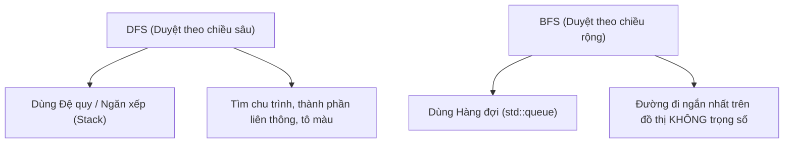

# 🏆 CP.07: Đồ Thị & Cây Căn Bản Cho Đề Thi Chuyên

&gt; **Mảnh ghép không thể thiếu**: Các bài toán đồ thị (Graph) và cây (Tree) thường xuất hiện dưới dạng các mô hình thực tế: mạng lưới giao thông, quan hệ bạn bè, hệ thống đường ống nước hoặc sơ đồ phân cấp tổ chức.

---

## 1. Biểu Diễn Đồ Thị Trong Thi Đấu

Thay vì dùng Ma trận kề tốn $O(V^2)$ bộ nhớ, tuyển thủ luôn dùng **Danh sách kề (Adjacency List)** bằng `std::vector`:

```cpp
#include <vector>
#include <iostream>

using namespace std;

const int MAXN = 1e5 + 5;
// Đồ thị có trọng số: adj[u] chứa danh sách các cặp {v, weight}
vector<pair<int, int>> adj[MAXN];

void add_edge(int u, int v, int w) {
    adj[u].push_back({v, w});
    adj[v].push_back({u, w}); // Nếu là đồ thị vô hướng
}
```

---

## 2. Tìm Kiếm Theo Chiều Rộng (BFS) & Chiều Sâu (DFS)



### Triển khai BFS tìm khoảng cách ngắn nhất:
```cpp
#include <vector>
#include <queue>
#include <iostream>

using namespace std;

void bfs(int start_node, int n, const vector<vector<int>>& adj) {
    vector<int> dist(n + 1, -1);
    queue<int> q;

    dist[start_node] = 0;
    q.push(start_node);

    while (!q.empty()) {
        int u = q.front();
        q.pop();

        for (int v : adj[u]) {
            if (dist[v] == -1) { // Chưa được thăm
                dist[v] = dist[u] + 1;
                q.push(v);
            }
        }
    }
}
```

---

## 3. Cấu Trúc Dữ Liệu Tập Hợp Rời Rạc (Disjoint Set Union - DSU)

DSU là cấu trúc dữ liệu thần thánh với độ phức tạp gần như $O(1)$ (chính xác là $O(\alpha(N))$ hàm Ackermann ngược). Nó giải quyết bài toán: kiểm tra xem hai đỉnh có thuộc cùng một thành phần liên thông hay không, và hợp nhất hai nhóm lại với nhau.

```cpp
#include <vector>
#include <numeric>
#include <iostream>

using namespace std;

struct DSU {
    vector<int> parent;
    vector<int> sz;

    DSU(int n) {
        parent.resize(n + 1);
        iota(parent.begin(), parent.end(), 0); // parent[i] = i
        sz.assign(n + 1, 1);
    }

    // Nén đường đi (Path Compression)
    int find(int u) {
        if (u == parent[u]) return u;
        return parent[u] = find(parent[u]);
    }

    // Hợp nhất theo kích thước (Union by Size)
    bool unite(int u, int v) {
        u = find(u);
        v = find(v);
        if (u == v) return false; // Đã cùng một nhóm
        if (sz[u] < sz[v]) swap(u, v);
        parent[v] = u;
        sz[u] += sz[v];
        return true;
    }
};
```

---

## 4. Thuật Toán Dijkstra Tìm Đường Đi Ngắn Nhất $O((V + E) \log V)$

Dijkstra tìm đường đi ngắn nhất từ đỉnh nguồn đến tất cả các đỉnh khác trên đồ thị có **trọng số không âm**:

```cpp
#include <vector>
#include <queue>
#include <iostream>

using namespace std;
using ll = long long;
const ll LINF = 1e18;

vector<ll> dijkstra(int start, int n, const vector<vector<pair<int, int>>>& adj) {
    vector<ll> dist(n + 1, LINF);
    // Min-heap lưu {khoảng cách, đỉnh}: greater<> xếp khoảng cách nhỏ nhất lên đầu
    priority_queue<pair<ll, int>, vector<pair<ll, int>>, greater<pair<ll, int>>> pq;

    dist[start] = 0;
    pq.push({0, start});

    while (!pq.empty()) {
        auto [d, u] = pq.top(); // Structured Binding C++17
        pq.pop();

        if (d > dist[u]) continue; // Đã tìm được đường ngắn hơn trước đó

        for (const auto& [v, weight] : adj[u]) {
            if (dist[u] + weight < dist[v]) {
                dist[v] = dist[u] + weight;
                pq.push({dist[v], v});
            }
        }
    }

    return dist;
}
```

---

## 5. Cây Khung Nhỏ Nhất (Kruskal MST)

Tìm tập hợp các cạnh kết nối toàn bộ $N$ đỉnh với tổng trọng số nhỏ nhất mà không tạo thành chu trình:

```cpp
#include <vector>
#include <tuple>
#include <algorithm>
#include <iostream>

using namespace std;
using ll = long long;

struct Edge {
    int u, v, weight;
    bool operator<(const Edge& other) const {
        return weight < other.weight; // Sắp xếp trọng số tăng dần
    }
};

ll kruskal(int n, vector<Edge>& edges, DSU& dsu) {
    sort(edges.begin(), edges.end());
    ll total_weight = 0;
    int edges_count = 0;

    for (const auto& [u, v, w] : edges) {
        if (dsu.unite(u, v)) { // Nếu không tạo chu trình
            total_weight += w;
            if (++edges_count == n - 1) break;
        }
    }

    return total_weight;
}
```
