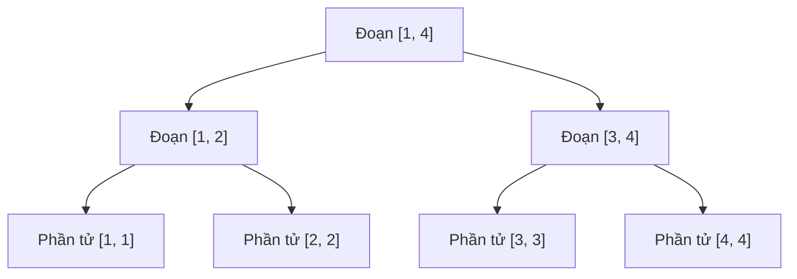

# 🏆 CP.08: Cây Phân Đoạn (Segment Tree) & Cây Fenwick (BIT)

&gt; **Cấu trúc dữ liệu quyền lực nhất**: Khi một bài toán đòi hỏi vừa **cập nhật giá trị phần tử** vừa **truy vấn tổng/min/max trên đoạn $[L, R]$** liên tục hàng trăm nghìn lần, mảng cộng dồn thông thường sẽ thất bại vì thao tác cập nhật mất $O(N)$. Cây Fenwick và Segment Tree giải quyết cả hai thao tác này chỉ trong $O(\log N)$!

---

## 1. Cây Fenwick (Binary Indexed Tree - BIT) Siêu Gọn Nhẹ

Cây Fenwick chỉ mất **10 dòng code** nhưng giải quyết bài toán:
- Thêm giá trị $val$ vào vị trí $idx$: `add(idx, val)` trong $O(\log N)$.
- Tính tổng tiền tố từ $1$ đến $idx$: `query(idx)` trong $O(\log N)$.
- Tính tổng đoạn $[L, R]$ trong $O(\log N)$: `query(R) - query(L - 1)`.

```cpp
#include <vector>
#include <iostream>

using namespace std;
using ll = long long;

struct FenwickTree {
    int n;
    vector<ll> tree;

    FenwickTree(int n) : n(n), tree(n + 1, 0) {}

    // Cộng thêm 'delta' vào vị trí 'idx' (chỉ số tính từ 1)
    void add(int idx, ll delta) {
        for (; idx <= n; idx += idx & -idx) { // Phép bù 2 lấy bit 1 thấp nhất
            tree[idx] += delta;
        }
    }

    // Tính tổng từ 1 đến idx
    ll query(int idx) {
        ll sum = 0;
        for (; idx > 0; idx -= idx & -idx) {
            sum += tree[idx];
        }
        return sum;
    }

    // Truy vấn tổng đoạn [l, r]
    ll query_range(int l, int r) {
        return query(r) - query(l - 1);
    }
};

int main() {
    FenwickTree ft(5);
    ft.add(1, 3);
    ft.add(2, 5);
    ft.add(3, 2);
    ft.add(4, 8);
    ft.add(5, 1);

    cout << "Tong doan [2, 4]: " << ft.query_range(2, 4) << '\n'; // 5 + 2 + 8 = 15

    ft.add(3, 10); // Tăng phần tử thứ 3 thêm 10
    cout << "Tong doan [2, 4] sau khi cap nhat: " << ft.query_range(2, 4) << '\n'; // 25

    return 0;
}
```

---

## 2. Cây Phân Đoạn (Segment Tree) Đa Năng

Segment Tree mạnh hơn Fenwick vì nó có thể xử lý hầu như mọi phép toán kết hợp: tổng, tìm giá trị nhỏ nhất (RMQ - Range Minimum Query), tìm giá trị lớn nhất, GCD, v.v.



### Triển khai Segment Tree tìm Min trên đoạn (Point Update, Range Query):
```cpp
#include <vector>
#include <algorithm>
#include <iostream>

using namespace std;

const int INF = 1e9 + 7;

struct SegmentTree {
    int n;
    vector<int> st;

    SegmentTree(int n) : n(n), st(4 * n, INF) {}

    // Xây dựng cây từ mảng ban đầu
    void build(const vector<int>& a, int id, int l, int r) {
        if (l == r) {
            st[id] = a[l];
            return;
        }
        int mid = (l + r) / 2;
        build(a, 2 * id, l, mid);
        build(a, 2 * id + 1, mid + 1, r);
        st[id] = min(st[2 * id], st[2 * id + 1]);
    }

    // Cập nhật vị trí 'pos' thành giá trị 'val'
    void update(int id, int l, int r, int pos, int val) {
        if (l == r) {
            st[id] = val;
            return;
        }
        int mid = (l + r) / 2;
        if (pos <= mid) update(2 * id, l, mid, pos, val);
        else update(2 * id + 1, mid + 1, r, pos, val);
        st[id] = min(st[2 * id], st[2 * id + 1]);
    }

    // Truy vấn giá trị nhỏ nhất trên đoạn [u, v]
    int query_min(int id, int l, int r, int u, int v) {
        if (v < l || r < u) return INF; // Ngoài phạm vi
        if (u <= l && r <= v) return st[id]; // Nằm trọn trong phạm vi
        int mid = (l + r) / 2;
        return min(query_min(2 * id, l, mid, u, v),
                   query_min(2 * id + 1, mid + 1, r, u, v));
    }
};
```

---

## 3. Bảng So Sánh Nhanh: Khi Nào Dùng Gì?

| Tiêu chí | Mảng Cộng Dồn (Prefix Sum) | Cây Fenwick (BIT) | Cây Phân Đoạn (Segment Tree) |
| :--- | :--- | :--- | :--- |
| **Độ dài code** | 3 dòng | 10 dòng | 30 - 50 dòng |
| **Bộ nhớ** | $1 \times N$ | $1 \times N$ | $4 \times N$ |
| **Cập nhật** | $O(N)$ (Rất chậm) | $O(\log N)$ | $O(\log N)$ (Hỗ trợ cả Lazy Update) |
| **Truy vấn** | $O(1)$ | $O(\log N)$ | $O(\log N)$ |
| **Khi nào dùng?** | Mảng tĩnh KHÔNG thay đổi giá trị | Cần tính tổng, nghịch thế, mảng biến động | Tìm Min/Max, GCD, cập nhật cả đoạn |
